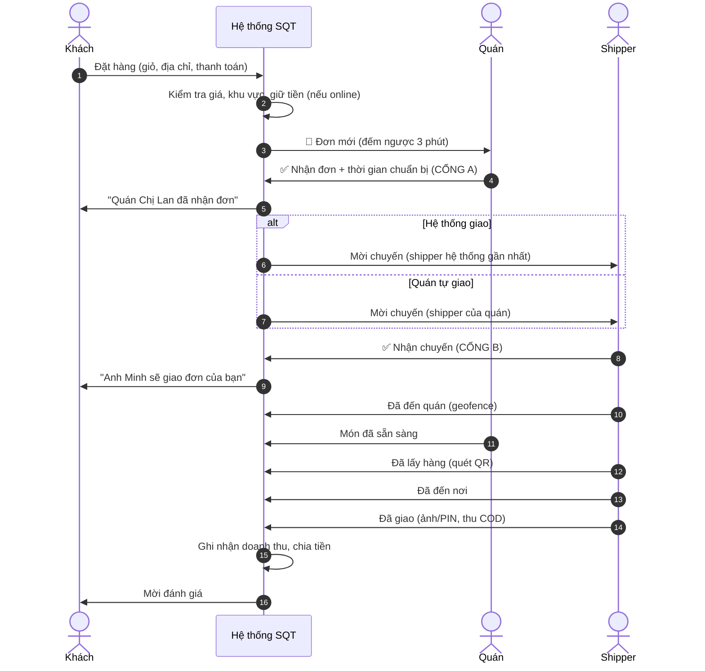
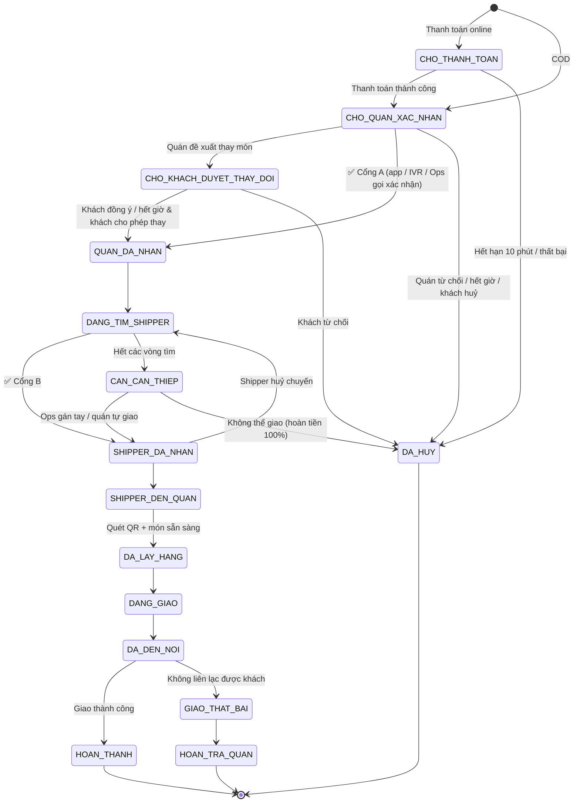

# Phần 3 — Luồng đặt hàng, Máy trạng thái & Cơ chế xác nhận

Đây là phần **quan trọng nhất** để hệ thống vận hành ổn định và đảm bảo nguyên tắc *"mọi đơn đều có người thật xác nhận"*.

---

## 3.1. Luồng tổng quát (Happy path)



> **Thời điểm điều phối shipper:** để tối ưu, hệ thống **bắt đầu tìm shipper sớm** sao cho shipper đến quán **đúng lúc món vừa xong**:
> `thời_điểm_mời = thời_điểm_quán_nhận + thời_gian_chuẩn_bị − ETA_shipper_tới_quán − 2 phút đệm`.
> Đơn ≤ 10 phút chuẩn bị → mời shipper ngay khi quán nhận.

---

## 3.2. Máy trạng thái đơn hàng (Order State Machine)



**Song song với trạng thái đơn**, có trạng thái **chuẩn bị món** của quán: `CHUA_BAT_DAU → DANG_LAM → SAN_SANG`. Shipper chỉ bấm *Đã lấy hàng* khi món `SAN_SANG` (hoặc quán xác nhận bàn giao).

### Quy tắc kỹ thuật bắt buộc
1. Mọi chuyển trạng thái đi qua **một dịch vụ duy nhất (Order Service)**, kiểm tra **bảng chuyển hợp lệ**; chuyển sai → từ chối.
2. Mỗi chuyển ghi một **sự kiện bất biến** vào `order_events` (ai – vai trò – thiết bị – toạ độ – thời gian – lý do).
3. Dùng **khoá lạc quan** (cột `version`) để tránh hai shipper cùng nhận một đơn: `UPDATE ... WHERE id=? AND version=? AND state='DANG_TIM_SHIPPER'`.
4. Mọi API thay đổi trạng thái nhận **Idempotency-Key** (mạng chập chờn bấm 2 lần không tạo 2 hành động).

---

## 3.3. Cổng A — Quán xác nhận: SLA & dự phòng

| Thời điểm (từ lúc đơn tới quán) | Hành động hệ thống |
|---|---|
| 0s | Đẩy thông báo + chuông toàn màn hình trên **tất cả thiết bị** của quán (chủ + nhân viên có quyền nhận đơn) |
| 45s | Nhắc lại chuông, gửi SMS/Zalo ZNS cho chủ quán |
| 90s | **Gọi IVR tự động**: "Quán có đơn mới 2 món, 85.000đ. Bấm 1 để nhận, bấm 2 để từ chối." → bấm 1 → hỏi thời gian chuẩn bị (bấm 1: 10 phút, 2: 20 phút, 3: 30 phút) |
| 150s | Đơn vào hàng đợi Ops (nếu khu vực có Ops trực) — Ops gọi trực tiếp quán |
| 180s | Huỷ tự động, **hoàn tiền 100%**, khách nhận voucher xin lỗi + gợi ý 3 quán tương tự có món tương tự |

- Quán bị **lỡ đơn** nhiều: lần 1 nhắc nhở; ≥ 3 lần/ngày → **tự động chuyển "Tạm nghỉ"** 30 phút và báo chủ quán (tránh khách tiếp tục đặt vào quán không người trực).
- Khách luôn thấy trạng thái: *"Đang chờ quán xác nhận… (1:24)"* và nút *Huỷ miễn phí*.
- **Xác nhận ghi nhận người thật**: lưu `confirmed_by_user_id`, kênh (`APP` / `IVR` / `OPS_CALL`), thời gian. Với IVR, lưu bản ghi âm cuộc gọi làm bằng chứng.

## 3.4. Cổng B — Shipper xác nhận: Thuật toán điều phối (Dispatch)

### 3.4.1. Chế độ "Hệ thống giao"
Tìm shipper theo **vòng mở rộng** (wave):

| Vòng | Bán kính tới quán | Số shipper mời đồng thời | Thời gian mỗi vòng |
|---|---|---|---|
| 1 | ≤ 1,5 km | 1 (người phù hợp nhất) | 20 giây |
| 2 | ≤ 2,5 km | 1 | 20 giây |
| 3 | ≤ 3,5 km | 3 (ai nhận trước được) | 25 giây |
| 4 | ≤ 5 km | 5 + **tăng thưởng +5.000đ** | 30 giây |
| 5 | — | Đẩy vào hàng đợi Ops | Ops gán tay / gọi shipper |

**Điểm phù hợp** của shipper (càng cao càng được mời trước):

```
score = w1 * (1 / ETA_tới_quán)
      + w2 * độ_thuận_đường (nếu đang có đơn, tính phụ phí lộ trình)
      + w3 * điểm_tin_cậy (tỷ lệ hoàn thành, đánh giá, tỷ lệ nhận chuyến)
      + w4 * công_bằng (ưu tiên người đã lâu chưa có chuyến)
      − w5 * phạt (quá giới hạn COD, loại xe không phù hợp hàng nặng)
```
Điều kiện loại trừ: không đủ ký quỹ COD, loại xe không phù hợp, đang bị tạm khoá, đang có ≥ 2 đơn.

### 3.4.2. Chế độ "Quán tự giao"
1. Đơn hiển thị trên app của **mọi shipper của quán đang trực tuyến** → ai bấm nhận trước được (hoặc chủ quán gán tay).
2. Sau 3 phút không ai nhận:
   - Nếu quán bật **"Dự phòng hệ thống"** → chuyển sang thuật toán 3.4.1.
   - Nếu không → chuông nhắc chủ quán; chủ quán có thể **tự đánh dấu "Tôi tự giao"** (chủ quán cũng là một người giao đã đăng ký).
3. Shipper của quán vẫn phải đi qua đủ các bước (đến quán → lấy hàng → giao), có GPS tracking để khách theo dõi như bình thường.

### 3.4.3. Shipper huỷ sau khi đã nhận
- Đơn quay lại `DANG_TIM_SHIPPER`, **ưu tiên cao nhất** trong vòng tìm, tăng thưởng tự động.
- Khách được báo: *"Đang đổi shipper, đơn của bạn vẫn được ưu tiên."*

## 3.5. Chính sách huỷ đơn

| Ai huỷ | Thời điểm | Hậu quả |
|---|---|---|
| Khách | Trước khi quán nhận | Miễn phí, hoàn 100% |
| Khách | Sau khi quán nhận, trước khi quán bắt đầu làm (≤ 2 phút) | Miễn phí (giới hạn 3 lần/tháng) |
| Khách | Quán đã làm món | Trả tiền món (quán nhận) + phí ship nếu shipper đã đến quán |
| Khách | Shipper đã lấy hàng | Không hoàn tiền; COD từ chối nhận nhiều lần → khoá COD |
| Quán | Bất kỳ lúc nào sau khi nhận | Hoàn 100% cho khách, quán bị trừ điểm uy tín; ≥ 3%/tuần → cảnh báo, giảm hiển thị |
| Shipper | Sau khi nhận | Tìm lại shipper; trừ điểm tin cậy; có lý do chính đáng (tai nạn, hỏng xe) → không phạt |
| Hệ thống | Không tìm được shipper / quán | Hoàn 100% + voucher xin lỗi |

## 3.6. Xử lý ngoại lệ (Edge cases)

| Tình huống | Cách xử lý |
|---|---|
| Hết 1 món sau khi đã nhận đơn | Quán bấm "Điều chỉnh" → khách duyệt thay thế / hoàn tiền phần món |
| Giá thực tế khác (hàng tạp hoá tính theo cân) | Đơn "giá ước tính": khách giữ tiền tối đa +15%; quán nhập giá thực + ảnh cân → khách xác nhận |
| Shipper bị tai nạn giữa đường | SOS → Ops liên hệ, đổi shipper khác tới vị trí; hàng hỏng → hoàn tiền cho khách, quán vẫn được trả |
| Khách không có ở nhà | Gọi 3 lần + nhắn tin + chờ 10 phút → theo chỉ dẫn khách (bảo vệ, hàng xóm) hoặc hoàn về quán, khách chịu phí ship |
| Mất mạng ở app quán/shipper | App lưu hành động offline & đồng bộ lại; IVR là kênh dự phòng cho quán; shipper có thể gọi tổng đài để Ops cập nhật hộ |
| Thanh toán online thành công nhưng callback chậm | Đơn ở `CHO_THANH_TOAN`; job đối chiếu với cổng thanh toán mỗi 30s; không trùng tiền nhờ idempotency |
| Hai đơn đặt trùng (khách bấm 2 lần) | Idempotency-Key trên checkout; cảnh báo "Bạn vừa đặt đơn giống hệt 1 phút trước" |
| Khu vực mưa lớn/ngập | Ops bật "chế độ thời tiết": tăng phí ship có thông báo, tăng thưởng shipper, nới ETA, thu hẹp bán kính |
| Quán đóng cửa đột xuất khi đang có đơn | Quán phải xử lý hết đơn đang có trước khi tắt; nếu ép tắt → đơn chuyển Ops |

## 3.7. Thông báo theo sự kiện

| Sự kiện | Khách | Quán | Shipper |
|---|---|---|---|
| Đơn mới | — | 🔔 Chuông lớn + push + (IVR) | — |
| Quán nhận | Push + trong app | — | — |
| Mời chuyến | — | — | 🔔 Chuông + full screen |
| Shipper nhận | Push (tên, ảnh, biển số) | Push | — |
| Món sẵn sàng | — | — | Push |
| Shipper sắp tới (≤ 500 m) | Push "Chuẩn bị nhận hàng" | — | — |
| Đã giao | Push + mời đánh giá | Push | — |
| Có vấn đề | Push + SMS | Push | Push |

Kênh: **FCM/APNs** (push), **WebSocket** (trong app), **Zalo ZNS / SMS** (dự phòng & OTP), **IVR** (quán).
