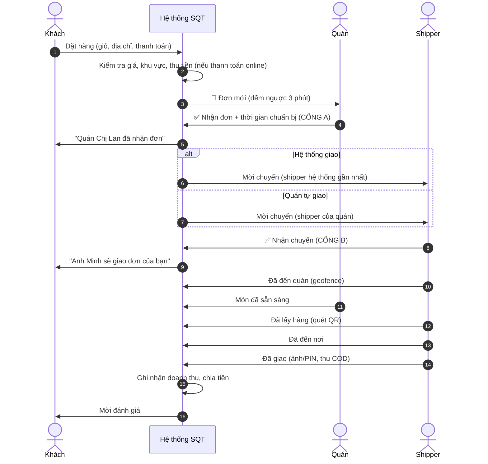
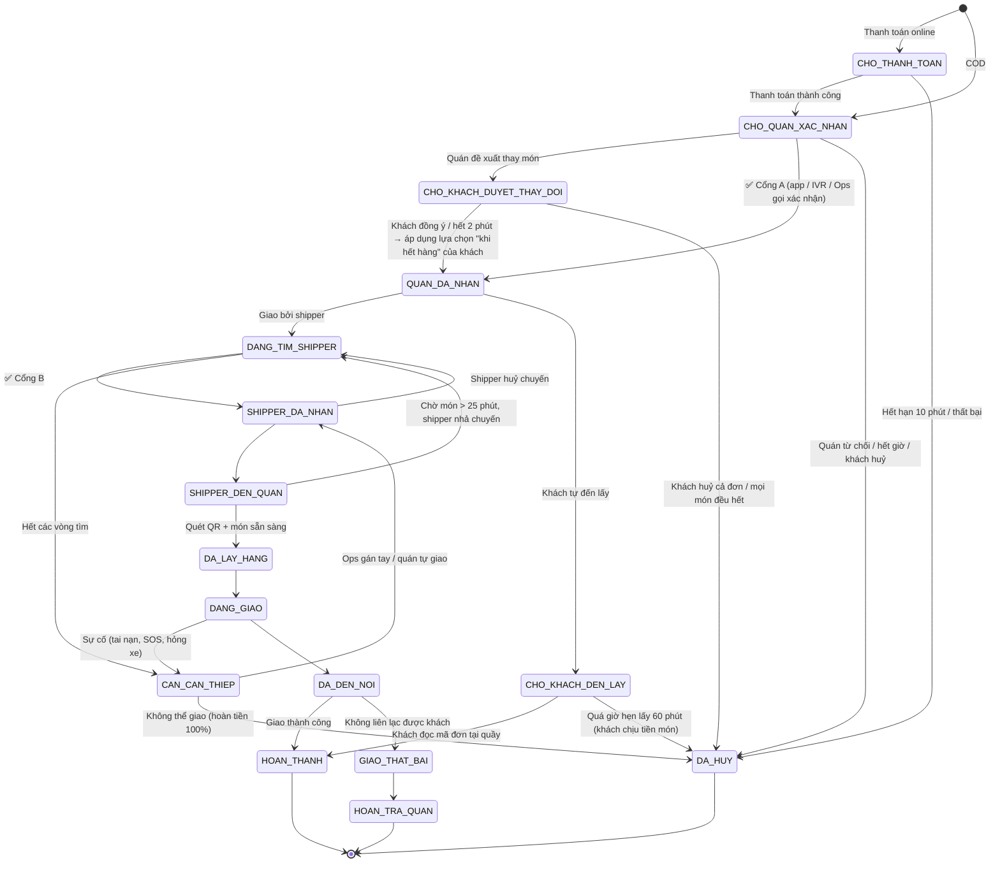

# Phần 3 — Luồng đặt hàng, Máy trạng thái & Cơ chế xác nhận

Đây là phần **quan trọng nhất** để hệ thống vận hành ổn định và đảm bảo nguyên tắc *"mọi đơn đều có người thật xác nhận"*.

---

## 3.1. Luồng tổng quát (Happy path)



> **Thời điểm điều phối shipper:** để tối ưu, hệ thống **bắt đầu tìm shipper sớm** sao cho shipper đến quán **đúng lúc món vừa xong**:
> `thời_điểm_mời = thời_điểm_quán_nhận + thời_gian_chuẩn_bị − ETA_shipper_tới_quán − 2 phút đệm`.
> Đơn ≤ 10 phút chuẩn bị → mời shipper ngay khi quán nhận.

---

## 3.2. Máy trạng thái đơn hàng (Order State Machine)



**Song song với trạng thái đơn**, có trạng thái **chuẩn bị món** của quán: `CHUA_BAT_DAU → DANG_LAM → SAN_SANG`. Shipper chỉ bấm *Đã lấy hàng* khi món `SAN_SANG` (hoặc quán xác nhận bàn giao).

### Quy tắc kỹ thuật bắt buộc
1. Mọi chuyển trạng thái đi qua **một dịch vụ duy nhất (Order Service)**, kiểm tra **bảng chuyển hợp lệ**; chuyển sai → từ chối.
2. Mỗi chuyển ghi một **sự kiện bất biến** vào `order_events` (ai – vai trò – thiết bị – toạ độ – thời gian – lý do).
3. Dùng **khoá lạc quan** (cột `version`) để tránh hai shipper cùng nhận một đơn: `UPDATE ... WHERE id=? AND version=? AND state='DANG_TIM_SHIPPER'`.
4. Mọi API thay đổi trạng thái nhận **Idempotency-Key** (mạng chập chờn bấm 2 lần không tạo 2 hành động).

---

> **Đơn hẹn giờ** có máy trạng thái riêng trước giờ hẹn (quán nhận → đăng lên chợ chuyến hẹn → shipper giữ chuyến → xác nhận lại T−30/T−20), sau đó nhập vào luồng chuẩn tại `SHIPPER_DA_NHAN`. Xem [Phần 10](10-don-hen-gio.md).

## 3.3. Cổng A — Quán xác nhận: SLA & dự phòng

Admin cài **một con số** cho cả hệ thống: *thời gian chờ quán xác nhận* (`sla.gate_a.timeout_seconds`, mặc định **90 giây**, có thể đặt riêng theo ngành). Các mốc nhắc/gọi quán tự chia theo tỷ lệ; bảng dưới là mốc ở mức 180 giây — với mặc định 90 giây thì 23s / 45s / 60s / 90s.

| Thời điểm (từ lúc đơn tới quán) | Hành động hệ thống |
|---|---|
| 0s | Đẩy thông báo + chuông toàn màn hình trên **tất cả thiết bị** của quán (chủ + nhân viên có quyền nhận đơn) |
| 45s | Nhắc lại bằng thông báo đẩy tới mọi thiết bị của quán |
| 90s | **Điều phối viên gọi quán**: Admin Console hiện việc "Gọi quán" kèm SĐT (bấm để mở app gọi) và lời đọc đơn có ghi chú, dị ứng; quán đồng ý thì Ops xác nhận thay (kênh `OPS_CALL`). *Thay cho cuộc gọi tự động (IVR) trả phí — xem 13.8.* |
| 120s | Hiện gợi ý cho khách: **"Chuyển sang hẹn giờ"** (giữ nguyên giỏ) hoặc chọn quán tương tự — *bỏ qua nếu đơn sẽ chuyển shipper mua hộ* |
| 180s | **Đơn giao tận nơi: chuyển sang "Shipper mua hộ"** (3.8) — mời shipper tới quán đặt món & giao, *không huỷ*; vẫn tính quán lỡ đơn. Đơn không mua hộ được (tự đến lấy, hẹn giờ, khách mới vượt mức, hoặc Admin tắt `proxy.fallback_on_store_silent`): huỷ tự động, **hoàn tiền 100%** + gợi ý quán tương tự |

- **Nhận đơn = cam kết làm theo ghi chú của từng món.** Ghi chú nào không làm được thì quán phải dùng *Nhận với điều chỉnh* (khách đồng ý) chứ không được bỏ qua. Đơn có ghi chú dị ứng cần thêm thao tác *"Đã đọc ghi chú dị ứng"* trước khi nhận.
- Quán bị **lỡ đơn** nhiều: lần 1 nhắc nhở; ≥ 3 lần/ngày → **tự động chuyển "Tạm nghỉ"** 30 phút và báo chủ quán (tránh khách tiếp tục đặt vào quán không người trực).
- Khách luôn thấy trạng thái: *"Đang chờ quán xác nhận… (1:24)"* và nút *Huỷ miễn phí*.
- **Xác nhận ghi nhận người thật**: lưu `confirmed_by_user_id`, kênh (`APP` / `IVR` / `OPS_CALL`), thời gian. Với IVR, lưu bản ghi âm cuộc gọi làm bằng chứng.

## 3.4. Cổng B — Shipper xác nhận: Thuật toán điều phối (Dispatch)

### 3.4.1. Chế độ "Hệ thống giao"
Tìm shipper theo **vòng mở rộng** (wave):

| Vòng | Bán kính tới quán | Số shipper mời đồng thời | Thời gian mỗi vòng |
|---|---|---|---|
| 1 | ≤ 1,5 km | 1 (người phù hợp nhất) | 20 giây |
| 2 | ≤ 2,5 km | 1 | 20 giây |
| 3 | ≤ 3,5 km | 3 (ai nhận trước được) | 25 giây |
| 4 | ≤ 5 km | 5 + **tăng thưởng +5.000đ** | 30 giây |
| 5 | — | **Lượt 2**: gọi lại quán (quán chưa nhận thì nhắc nhận đơn), báo khách "đang mời thêm một lượt", chờ `dispatch.retry_delay_seconds` (mặc định 60 giây) rồi mời lại vòng 1–4 — kể cả shipper đã được mời ở lượt 1 | |
| 6 | — | Vẫn không ai nhận: **có điều phối viên đang trực** → đẩy vào hàng đợi Ops (gán tay / gọi shipper). **Không ai trực** → huỷ (sự kiện `NO_RIDER_CANCEL`, hệ thống chỉ huỷ, không xác nhận thay), **hoàn tiền 100%**, báo khách và quán | |

**Điều phối viên** là tài khoản vai trò Ops/Admin (người của nền tảng) mở Admin Console để xử lý đơn kẹt và gọi quán. Được tính là **đang trực** khi Console đang mở trong `ops.on_duty_minutes` phút gần đây (mặc định 5). Khách **chỉ thấy** "Điều phối viên đang hỗ trợ" khi thật sự có người trực; ngược lại app nói rõ đơn đang được thử lại hoặc đã huỷ.

**Điểm phù hợp** của shipper (càng cao càng được mời trước):

```
score = w1 * (1 / ETA_tới_quán)
      + w2 * độ_thuận_đường (nếu đang có đơn, tính phụ phí lộ trình)
      + w3 * điểm_tin_cậy (tỷ lệ hoàn thành, đánh giá, tỷ lệ nhận chuyến)
      + w4 * công_bằng (ưu tiên người đã lâu chưa có chuyến)
      − w5 * phạt (quá giới hạn COD, loại xe không phù hợp hàng nặng)
```
Điều kiện loại trừ: vượt hạn mức COD, loại xe không phù hợp, không có quyền nhận loại đơn này (Phần 15.2), đang bị tạm khoá, đã đủ số đơn ghép tối đa được phép.

Điểm `score` sau đó được cộng **điều chỉnh ưu tiên của Admin** (nếu có, trong biên độ cho phép — Phần 15.5).

### 3.4.2. Chế độ "Quán tự giao"
1. Đơn hiển thị trên app của **mọi shipper của quán đang trực tuyến** → ai bấm nhận trước được (hoặc chủ quán gán tay).
2. Sau 3 phút không ai nhận:
   - Nếu quán bật **"Dự phòng hệ thống"** → chuyển sang thuật toán 3.4.1.
   - Nếu không → chuông nhắc chủ quán; chủ quán có thể **tự đánh dấu "Tôi tự giao"** (chủ quán cũng là một người giao đã đăng ký).
3. Shipper của quán vẫn phải đi qua đủ các bước (đến quán → lấy hàng → giao), có GPS tracking để khách theo dõi như bình thường.

### 3.4.3. Shipper huỷ sau khi đã nhận
- Đơn quay lại `DANG_TIM_SHIPPER`, **ưu tiên cao nhất** trong vòng tìm, tăng thưởng tự động.
- Khách được báo: *"Đang đổi shipper, đơn của bạn vẫn được ưu tiên."*

## 3.5. Chính sách huỷ đơn

| Ai huỷ | Thời điểm | Hậu quả |
|---|---|---|
| Khách | Trước khi quán nhận | Miễn phí, hoàn 100% |
| Khách | Sau khi quán nhận, trước khi quán bắt đầu làm (≤ 2 phút) | Miễn phí (giới hạn 3 lần/tháng) |
| Khách | Quán đã làm món | Trả tiền món (quán nhận) + phí ship nếu shipper đã đến quán |
| Khách | Shipper đã lấy hàng | Thanh toán online: không hoàn tiền. COD: không thu được tiền → quán và shipper **vẫn được trả đủ** (nền tảng chịu), khách bị ghi nhận *bỏ đơn COD*; 2 lần trong 90 ngày → tắt COD |
| Quán | Bất kỳ lúc nào sau khi nhận | Hoàn 100% cho khách, quán bị trừ điểm uy tín; ≥ 3%/tuần → cảnh báo, giảm hiển thị |
| Shipper | Sau khi nhận | Tìm lại shipper; trừ điểm tin cậy; có lý do chính đáng (tai nạn, hỏng xe) → không phạt |
| Hệ thống | Không tìm được shipper / quán | Hoàn 100% + voucher xin lỗi |

## 3.6. Xử lý ngoại lệ (Edge cases)

| Tình huống | Cách xử lý |
|---|---|
| Ghi chú tốn thêm chi phí (VD *"thêm trứng"*) | Quán đề xuất giá mới qua *Nhận với điều chỉnh* → khách đồng ý mới áp dụng; không đồng ý thì quán làm đúng món gốc hoặc từ chối món |
| Quán làm sai ghi chú (VD có hành dù ghi *không hành*) | Khách báo sự cố kèm ảnh → hoàn tiền món theo chính sách; tính vào chỉ số *Chính xác đơn hàng* của quán. Sai ghi chú dị ứng: xử lý mức nghiêm trọng cao nhất, CSKH cấp 2 liên hệ ngay |
| Hết 1 món sau khi đã nhận đơn | Quán bấm "Điều chỉnh" → khách duyệt thay thế / hoàn tiền phần món |
| Giá thực tế khác (hàng tạp hoá tính theo cân) | Đơn "giá ước tính": thanh toán online thu theo giá ước tính +15%, sau khi quán nhập giá thực + ảnh cân thì **hoàn phần chênh tự động**; COD thu theo giá thực. Giá thực vượt +15% → khách phải xác nhận lại |
| Shipper bị tai nạn giữa đường | SOS → Ops liên hệ, đổi shipper khác tới vị trí; hàng hỏng → hoàn tiền cho khách, quán vẫn được trả |
| Khách không có ở nhà | Gọi 3 lần + nhắn tin + chờ 10 phút (cấu hình được) → theo chỉ dẫn khách (bảo vệ, hàng xóm) hoặc hoàn về quán, khách chịu phí ship |
| Mất mạng ở app quán/shipper | App lưu hành động offline & đồng bộ lại; IVR là kênh dự phòng cho quán; shipper có thể gọi tổng đài để Ops cập nhật hộ |
| Thanh toán online thành công nhưng callback chậm | Đơn ở `CHO_THANH_TOAN`; job đối chiếu với cổng thanh toán mỗi 30s; không trùng tiền nhờ idempotency |
| Hai đơn đặt trùng (khách bấm 2 lần) | Idempotency-Key trên checkout; cảnh báo "Bạn vừa đặt đơn giống hệt 1 phút trước" |
| Khu vực mưa lớn/ngập | Ops bật "chế độ thời tiết": tăng phí ship có thông báo, tăng thưởng shipper, nới ETA, thu hẹp bán kính |
| Quán đóng cửa đột xuất khi đang có đơn | Quán phải xử lý hết đơn đang có trước khi tắt; nếu ép tắt → đơn chuyển Ops |

## 3.7. Thông báo theo sự kiện

| Sự kiện | Khách | Quán | Shipper |
|---|---|---|---|
| Đơn mới | — | 🔔 Chuông lớn + push + (IVR) | — |
| Quán nhận | Push + trong app | — | — |
| Mời chuyến | — | — | 🔔 Chuông + full screen |
| Shipper nhận | Push (tên, ảnh, biển số) | Push | — |
| Món sẵn sàng | — | — | Push |
| Shipper sắp tới (≤ 500 m) | Push "Chuẩn bị nhận hàng" | — | — |
| Đã giao | Push + mời đánh giá | Push | — |
| Có vấn đề | Push + SMS | Push | Push |

Kênh: **FCM/APNs** (push), **WebSocket** (trong app), **Zalo ZNS / SMS** (dự phòng & OTP), **IVR** (quán).

## 3.8. Ba chế độ nhận đơn & "Shipper mua hộ"

Admin chọn cho **từng quán** một chế độ (Admin Console → Quán → hồ sơ quán → *Chế độ nhận đơn*):

| Chế độ | Dùng cho | Luồng |
|---|---|---|
| 📱 **Quán tự nhận** (mặc định) | Quán có cài app | Cổng A (quán) → Cổng B (shipper) như 3.3–3.4. Quán im lặng hết hạn Cổng A (180 giây) thì đơn giao tận nơi **chuyển sang shipper mua hộ thay vì huỷ** (Admin tắt được) |
| 🛒 **Shipper mua hộ** | Quán không dùng app (vỉa hè, tạp hoá nhỏ) | Bỏ Cổng A; mời shipper ngay; shipper tới quán đặt món, ứng tiền, giao |
| 🔀 **Song song** | Quán có app nhưng hay lỡ đơn | Quán có **N giây** (mặc định 60) để nhận; im lặng thì mời shipper tới mua hộ. Trong lúc shipper đang tới, quán **vẫn nhận muộn được** → đơn quay về "quán làm món, shipper lấy" |

**Người thật xác nhận vẫn bắt buộc:** chuyển sang mua hộ *không* xác nhận đơn. Đơn chỉ có người lo khi shipper bấm nhận chuyến (Cổng B), và Cổng A được thay bằng việc **shipper đặt món trực tiếp tại quầy** (kênh `RIDER_PROXY`, ghi trong nhật ký đơn).

**Các bước của shipper mua hộ:**
1. Lời mời ghi rõ "🛒 MUA HỘ — ứng trước X đ". Chỉ mời shipper có **hạn mức ứng tiền** ≥ tiền món (Admin đặt cho từng shipper, mặc định 500.000đ).
2. Tới quán → **Đã đặt món với quán**: đọc món + ghi chú cho quán; đơn có dị ứng phải tick "đã đọc ghi chú dị ứng".
3. **Đã trả tiền & nhận món**: nhập tiền món thật, chụp hoá đơn/menu. Lệch quá **10%** so với app thì phải gọi khách, khách đồng ý mới xác nhận được. Tổng khách trả = tiền món thật + phí ship + phí dịch vụ (**không thu phí mua hộ** — đã nằm trong phí ship).
4. Giao như đơn thường (có mã nhận hàng nếu đơn lớn).
5. Tới nơi quán đóng cửa/hết món → **Quán không bán được**: đơn huỷ, khách được hoàn toàn bộ; shipper được ghi **tiền bù chuyến đi** (mặc định 10.000đ) để đối soát.

**Giới hạn:** chỉ giao tận nơi (không tự đến lấy, không hẹn giờ với quán mua hộ). **Khách mới** (chưa có đơn thành công) chỉ được mua hộ với tiền món **dưới 200.000đ**.

**Admin chỉnh được** (Cấu hình → nhóm `proxy`): bật/tắt chuyển shipper khi quán im lặng (`proxy.fallback_on_store_silent`, theo toàn hệ thống / ngành / từng quán), số giây chờ quán ở chế độ song song, mức tối đa cho khách mới, ngưỡng lệch giá, tiền bù chuyến đi; và hạn mức ứng tiền từng shipper (hồ sơ shipper).

**Khách luôn biết đơn đang ở đâu:** màn theo dõi đơn có hình động — sóng lan khi đợi quán, radar khi tìm shipper, xe chạy khi shipper đang tới/đang giao — kèm đồng hồ "đã chờ m:ss" và lời giải thích ("Quán chưa nhận trên app — đang tìm shipper tới quán mua giúp bạn"). Khách có thể **sao chép đơn** (kèm tên + SĐT người đặt) để gửi thẳng cho quán qua Zalo/SMS.
