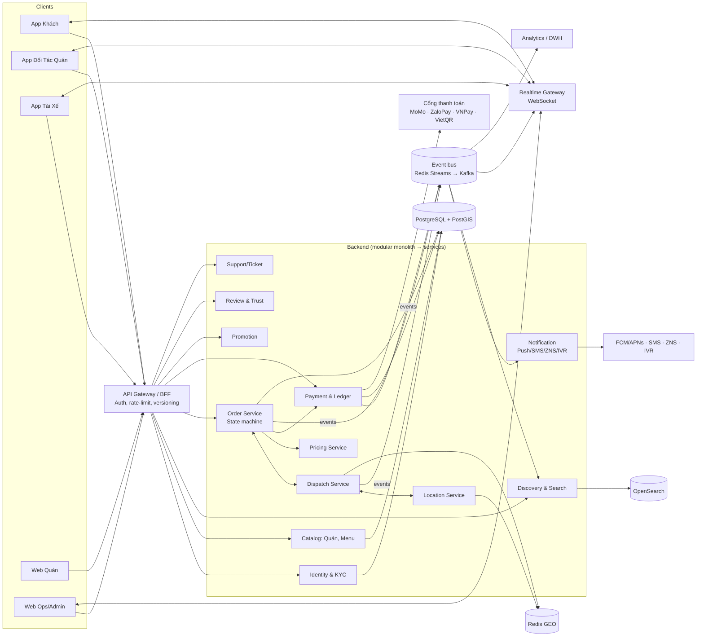

# Phần 5 — Kiến trúc kỹ thuật

Mục tiêu: **chuyên nghiệp, ổn định, mở rộng được**, nhưng **không phức tạp hoá sớm**. Bắt đầu bằng **"modular monolith"** (một khối nhưng chia module rõ ràng), tách dịch vụ khi tải thực sự đòi hỏi.

---

## 5.1. Lựa chọn công nghệ (đề xuất)

| Lớp | Công nghệ | Lý do |
|---|---|---|
| App di động (3 app) | **Flutter** (chốt) — một codebase iOS/Android | 1 đội làm 3 app; hiệu năng tốt trên Android giá rẻ, hoạt hình mượt (Lottie/Rive); chia sẻ thư viện UI, bản đồ, realtime |
| Web quản trị quán / Ops / Admin | **Next.js (React) + TypeScript**, UI kit (shadcn/ui, Ant Design) | Nhanh, SEO cho trang quán công khai |
| Backend API | **NestJS (TypeScript)** (chốt cho MVP) · **Go** cho Dispatch/Location khi tách dịch vụ | Một ngôn ngữ với web (TypeScript) → đội nhỏ làm nhanh; Go chỉ dùng khi tải đòi hỏi |
| CSDL chính | **PostgreSQL 16 + PostGIS** | Giao dịch ACID cho đơn & tiền; truy vấn không gian "quanh tôi" |
| Cache / khoá / hàng đợi nhẹ | **Redis** (GEO, Streams, distributed lock) | Vị trí shipper realtime, rate limit, phiên |
| Message bus & job hẹn giờ | **MVP: Outbox (PostgreSQL) + Redis Streams + BullMQ** · **Kafka** khi > 100.000 đơn/ngày | Ít thành phần vận hành hơn ở giai đoạn đầu = ổn định hơn với đội nhỏ |
| Tìm kiếm | **MVP: PostGIS + `unaccent` + `pg_trgm`** · **OpenSearch** từ bản 1.0 (analyzer tiếng Việt, bỏ dấu, embedding) | Tránh vận hành cụm tìm kiếm khi dữ liệu còn nhỏ |
| Realtime | **WebSocket** (Socket.IO / Centrifugo) | Theo dõi đơn, vị trí shipper |
| Bản đồ & định tuyến | Google Maps Platform / **Goong.io** (bản đồ VN) / tự host **OSRM/Valhalla** | Tính ETA, khoảng cách đường đi; tự host để giảm chi phí khi lớn |
| Chia lưới không gian | **Uber H3** | Hệ số cao điểm, bản đồ nhiệt theo ô |
| Lưu file | S3-compatible (AWS S3 / Viettel/VNG Cloud Object Storage) + CDN | Ảnh món, ảnh giao hàng, CCCD (mã hoá) |
| Push | Firebase Cloud Messaging + APNs | |
| SMS/OTP/ZNS | Nhà cung cấp SMS brandname + Zalo ZNS | |
| IVR / số ẩn | Tổng đài cloud (Stringee, VNPT, Twilio…) | Gọi xác nhận quán, gọi ẩn số |
| eKYC | Nhà cung cấp eKYC VN (FPT.AI, VNPT eKYC…) | OCR CCCD, so khớp khuôn mặt, liveness |
| AI | **Groq** (LLM + nhận dạng giọng nói) qua AI Gateway nội bộ, có nhà cung cấp dự phòng | Phản hồi rất nhanh — xem Phần 12 |
| Hạ tầng | **MVP: dịch vụ được quản lý** (PostgreSQL/Redis managed có bản sao & backup tự động, chạy container managed) · **Kubernetes** khi có ≥ 2 SRE; Terraform | Giảm rủi ro vận hành; ưu tiên cloud có vùng dữ liệu tại Việt Nam cho dữ liệu cá nhân |
| CI/CD | GitHub Actions → build image → ArgoCD | |
| Giám sát | Prometheus + Grafana, Loki (log), Tempo/Jaeger (trace), Sentry (lỗi app), PagerDuty/Opsgenie | |

## 5.2. Sơ đồ kiến trúc



## 5.3. Các module chính & trách nhiệm

| Module | Trách nhiệm | Dữ liệu sở hữu |
|---|---|---|
| **Identity & KYC** | OTP, JWT/refresh token, vai trò, eKYC, thiết bị | users, devices, kyc_records, roles |
| **Catalog** | Quán, chi nhánh, menu, tuỳ chọn, giờ mở cửa, tồn kho | merchants, stores, menu_items, modifiers, store_hours |
| **Discovery** | "Quanh tôi", tìm kiếm, xếp hạng, gợi ý | index OpenSearch (đọc từ Catalog qua event) |
| **Order** | Giỏ hàng, checkout, **máy trạng thái**, Cổng A | carts, orders, order_items, order_events |
| **Dispatch** | Tìm/mời shipper, Cổng B, ghép đơn, gán tay | dispatch_offers, assignments |
| **Location** | Nhận GPS shipper, geofence, ETA | Redis GEO + lịch sử điểm (time-series) |
| **Pricing** | Báo giá phí ship, cao điểm, phụ phí | pricing_rules, surge_cells, quotes |
| **Payment & Ledger** | Thu tiền, hoàn tiền, ví, sổ cái, đối soát, chi trả | payments, refunds, ledger_accounts, ledger_entries, payouts |
| **Promotion** | Voucher, chương trình, ngân sách, chống lạm dụng | promotions, vouchers, redemptions |
| **Notification** | Template, kênh, retry, IVR | notifications, ivr_calls |
| **Review & Trust** | Đánh giá, điểm tin cậy, cờ gian lận | reviews, trust_scores, fraud_flags |
| **Support** | Ticket, sự cố, bồi hoàn, audit | tickets, incidents, audit_logs |

## 5.4. Luồng realtime vị trí shipper
1. App tài xế gửi GPS **mỗi 4s khi đang có chuyến**, **mỗi 15–30s khi rảnh** (tiết kiệm pin), gom lô khi mạng yếu.
2. Location Service: lọc nhiễu (Kalman / snap-to-road), cập nhật `GEOADD riders:online` trong Redis, ghi lịch sử vào kho time-series (TimescaleDB / ClickHouse).
3. Đẩy vị trí tới **chỉ những khách/quán đang theo dõi đơn đó** qua kênh WebSocket `order:{id}`.
4. Dispatch truy vấn `GEOSEARCH riders:online FROMLONLAT ... BYRADIUS 2.5 km` → lọc điều kiện → tính ETA qua routing engine → chấm điểm.

## 5.5. Truy vấn "Quanh tôi" (Discovery)

> MVP dùng truy vấn PostGIS (Phần 6.3) + cache theo ô H3; mô tả dưới đây áp dụng từ bản 1.0 khi chuyển sang OpenSearch.

- Chỉ mục `stores` trong OpenSearch có trường `geo_point`, `is_open`, `categories`, `rating`, `prep_time_avg`, `delivery_modes`, `delivery_radius`.
- Truy vấn: `geo_distance ≤ R` **và** khách nằm trong `delivery_radius` của quán **và** `is_open` → xếp hạng bằng `function_score`:
  ```
  rank = a·gần + b·ETA_đến_tay + c·rating + d·tỷ_lệ_xác_nhận + e·cá_nhân_hoá + f·quảng_cáo(được gắn nhãn "Tài trợ")
  ```
- `ETA_đến_tay ≈ thời_gian_chuẩn_bị_TB + thời_gian_tìm_shipper_TB(vùng) + thời_gian_di_chuyển`.
- Trạng thái `is_open` / *Đông khách* cập nhật realtime qua event (không chờ re-index định kỳ).
- Cache kết quả theo **ô H3 cấp 8 + bộ lọc** trong 30–60 giây để chịu tải giờ cao điểm.

## 5.6. Độ tin cậy & tính nhất quán
- **Transactional Outbox**: ghi thay đổi đơn + bản ghi `outbox` trong cùng 1 transaction → worker đẩy lên event bus (Redis Streams ở MVP, Kafka khi lớn) → đảm bảo không mất sự kiện.
- **Idempotency** cho mọi API ghi và mọi consumer (bảng `processed_events`).
- **Saga** cho luồng thanh toán–đơn: giữ tiền → tạo đơn → (huỷ) hoàn tiền bù trừ.
- **Retry có backoff + dead-letter queue** cho thông báo, webhook thanh toán.
- **Circuit breaker** & timeout cho dịch vụ bên ngoài (bản đồ, SMS, cổng thanh toán); có nhà cung cấp dự phòng cho SMS/OTP và bản đồ.
- **Bộ hẹn giờ SLA** (Cổng A, Cổng B, giao trễ) chạy bằng **delayed job** bền vững (**BullMQ trên Redis có bật lưu trữ AOF**, kèm job quét đối chiếu mỗi phút từ PostgreSQL để không job nào bị mất) — không dùng `setTimeout` trong RAM.
- Hoạt động **khi mất kết nối**: app quán/shipper lưu hàng đợi thao tác cục bộ, gửi lại với cùng Idempotency-Key.

## 5.7. Hiệu năng & quy mô (mục tiêu thiết kế)

| Chỉ tiêu | Mục tiêu |
|---|---|
| Thời gian tải danh sách "Quanh tôi" (p95) | < 300 ms phía server, < 1,5 s trên 4G |
| API đặt hàng (p95) | < 500 ms |
| Độ trễ cập nhật trạng thái tới app | < 2 s |
| Độ trễ vị trí shipper hiển thị | < 5 s |
| Tải giai đoạn 1 | 10.000 đơn/ngày, 2.000 shipper online, đỉnh 30 đơn/giây |
| Thiết kế mở rộng tới | 500.000 đơn/ngày (tách Dispatch/Location ra service riêng, shard theo thành phố) |
| Uptime | 99,9% (Order, Dispatch, Payment: 99,95%) |
| RPO / RTO | RPO ≤ 5 phút, RTO ≤ 30 phút |

## 5.8. Bảo mật
- Xác thực: OTP → **JWT truy cập ngắn hạn (15 phút) + refresh token xoay vòng**, gắn thiết bị; đăng xuất thiết bị từ xa.
- Phân quyền: RBAC + kiểm tra **quyền theo tài nguyên** (nhân viên quán chỉ thấy đơn quán mình; shipper chỉ thấy địa chỉ chi tiết khách **sau khi nhận chuyến** và **ẩn sau khi hoàn thành 2 giờ**).
- **Số điện thoại ẩn** giữa các bên; chat lọc SĐT/thông tin nhạy cảm.
- Mã hoá: TLS 1.2+ toàn bộ; mã hoá lúc lưu (ảnh CCCD, tài khoản ngân hàng bằng KMS, trường nhạy cảm mã hoá cấp cột).
- Bảo vệ API: rate limit theo IP/thiết bị/user, WAF, chống bot đăng ký, **chống giả GPS** (phát hiện mock location, root/jailbreak, tốc độ di chuyển bất thường).
- Tuân thủ **Nghị định 13/2023/NĐ-CP về bảo vệ dữ liệu cá nhân** (và các văn bản liên quan): xin đồng ý rõ ràng, mục đích xử lý, quyền xoá tài khoản/dữ liệu, đánh giá tác động xử lý dữ liệu; lưu trữ dữ liệu theo quy định về an ninh mạng.
- Kiểm thử xâm nhập (pentest) trước khi ra mắt & định kỳ 6 tháng; chương trình bug bounty khi lớn.
- Audit log bất biến cho mọi thao tác của nhân viên nội bộ (xem dữ liệu khách, hoàn tiền, gán tay đơn).

## 5.9. Quan sát & vận hành (SRE)
- **Dashboard nghiệp vụ realtime**: đơn/phút, tỷ lệ quán xác nhận, thời gian tìm shipper, đơn kẹt — cảnh báo khi lệch ngưỡng (đây thường là dấu hiệu sự cố sớm nhất).
- Distributed tracing gắn `order_id` xuyên suốt.
- Cảnh báo theo SLO (error budget), trực on-call 24/7 giờ cao điểm.
- Triển khai **canary / blue-green**, **feature flag** cho mọi tính năng mới; rollback 1 lệnh.
- **Kiểm thử tải** trước sự kiện lớn (giờ trưa, ngày lễ, mưa bão); **chaos test** dịch vụ bên ngoài sập.
- Sao lưu PostgreSQL: PITR liên tục + bản sao đọc; diễn tập khôi phục mỗi quý.

## 5.10. Yêu cầu của kho ứng dụng & hệ điều hành
- **Vị trí nền (shipper):** Android dùng *foreground service* có thông báo thường trực khi đang online; iOS dùng chế độ cập nhật vị trí nền với lý do rõ ràng — chỉ theo dõi khi **online/đang có chuyến**, tắt hoàn toàn khi offline. Giải thích quyền trước khi xin.
- **Thông báo đơn mới (quán) & mời chuyến (shipper):** dùng thông báo ưu tiên cao + kênh âm thanh riêng; hướng dẫn tắt tối ưu pin (nhiều máy Android tự diệt ứng dụng nền) ngay trong onboarding, có màn hình **"Kiểm tra máy của bạn"** (thử chuông, thử nhận đơn mẫu).
- **Đăng nhập Apple** khi có đăng nhập mạng xã hội trên iOS; **xoá tài khoản trong app**; nhãn quyền riêng tư (App Privacy / Data safety) khai báo đúng.
- Hỗ trợ tối thiểu Android 8+, iOS 15+; kiểm thử trên các dòng máy phổ biến giá rẻ.

## 5.11. Chế độ vận hành suy giảm (khi một phần hệ thống gặp sự cố)

Mục tiêu: **không bao giờ "sập toàn bộ"** — mỗi sự cố chỉ làm mất tính năng phụ, đơn hàng vẫn đi được.

| Sự cố | Chế độ suy giảm |
|---|---|
| Cổng thanh toán online lỗi | Tạm ẩn phương thức đó, **chỉ COD/VietQR**; đơn đang chờ thanh toán được đối chiếu lại khi cổng hoạt động |
| Dịch vụ SMS/OTP lỗi | Chuyển nhà cung cấp dự phòng → Zalo ZNS → OTP qua cuộc gọi; phiên đăng nhập cũ vẫn dùng được |
| Bản đồ/định tuyến lỗi | Chuyển nhà cung cấp dự phòng → ước tính khoảng cách đường chim bay × 1,3; phí ship tính theo bảng bậc cố định |
| Điều phối (dispatch) lỗi | Đơn chuyển sang **bảng chuyến mở** (shipper trong khu tự chọn như chợ chuyến hẹn) + Ops gán tay; quán tự giao không bị ảnh hưởng |
| Realtime (WebSocket) lỗi | App tự chuyển sang hỏi định kỳ 10 giây + push |
| Push (FCM/APNs) chậm | Tăng tần suất IVR/SMS cho đơn mới của quán |
| AI (Groq) lỗi | Ẩn tính năng AI, dùng giao diện thường (Phần 12.5) |
| Cơ sở dữ liệu chính sự cố | Chuyển sang bản sao dự phòng tự động (failover); trang trạng thái + tạm khoá đặt đơn mới tối đa vài phút, đơn đang giao tiếp tục nhờ dữ liệu lưu trên app shipper |

- Mỗi chế độ có **công tắc (feature flag)** cho Ops bật tay và **kích hoạt tự động** theo cảnh báo.
- **Diễn tập sự cố mỗi tháng** (tắt thử từng dịch vụ ngoài trên môi trường staging; mỗi quý trên production ngoài giờ cao điểm).

## 5.12. Kiểm thử
- Unit test cho máy trạng thái (100% các chuyển hợp lệ/không hợp lệ), pricing, ledger (tổng bút toán luôn = 0).
- Integration test với cổng thanh toán sandbox.
- **Mô phỏng (simulation)**: bộ giả lập hàng nghìn khách/quán/shipper ảo chạy trên bản đồ thật để tinh chỉnh thuật toán dispatch trước khi ra mắt.
- E2E trên thiết bị thật (Android giá rẻ là ưu tiên — phần lớn shipper/quán dùng máy cấu hình thấp).
