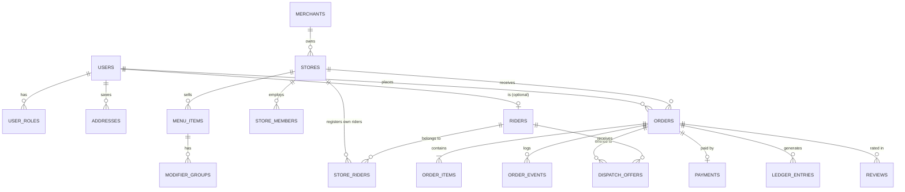

# Phần 6 — Mô hình dữ liệu & Đặc tả API

---

## 6.1. Sơ đồ quan hệ thực thể (rút gọn)



## 6.2. Lược đồ SQL các bảng cốt lõi (PostgreSQL + PostGIS)

```sql
-- Người dùng & vai trò
CREATE TABLE users (
  id            BIGSERIAL PRIMARY KEY,
  phone         VARCHAR(15) UNIQUE NOT NULL,
  full_name     VARCHAR(120),
  avatar_url    TEXT,
  status        VARCHAR(20) NOT NULL DEFAULT 'ACTIVE', -- ACTIVE, SUSPENDED, DELETED
  created_at    TIMESTAMPTZ NOT NULL DEFAULT now()
);

CREATE TABLE user_roles (
  user_id   BIGINT REFERENCES users(id),
  role      VARCHAR(30) NOT NULL, -- CUSTOMER, MERCHANT_OWNER, MERCHANT_STAFF, RIDER, OPS, SUPPORT, ADMIN, FINANCE
  scope_id  BIGINT,               -- store_id với vai trò quán
  PRIMARY KEY (user_id, role, scope_id)
);

CREATE TABLE addresses (
  id         BIGSERIAL PRIMARY KEY,
  user_id    BIGINT REFERENCES users(id),
  label      VARCHAR(30),               -- Nhà, Công ty...
  full_text  TEXT NOT NULL,
  location   GEOGRAPHY(POINT, 4326) NOT NULL,
  note       TEXT,                      -- chỉ dẫn cho shipper
  is_default BOOLEAN DEFAULT false
);

-- Quán
CREATE TABLE merchants (
  id            BIGSERIAL PRIMARY KEY,
  owner_user_id BIGINT REFERENCES users(id),
  legal_name    VARCHAR(200),
  tax_code      VARCHAR(20),
  kyc_status    VARCHAR(20) NOT NULL DEFAULT 'PENDING', -- PENDING, NEED_MORE, APPROVED, REJECTED
  bank_account_enc BYTEA                                 -- mã hoá bằng KMS
);

CREATE TABLE stores (
  id                 BIGSERIAL PRIMARY KEY,
  merchant_id        BIGINT REFERENCES merchants(id),
  name               VARCHAR(160) NOT NULL,
  category           VARCHAR(40) NOT NULL,
  location           GEOGRAPHY(POINT, 4326) NOT NULL,
  address_text       TEXT NOT NULL,
  zone_id            BIGINT,
  delivery_mode      VARCHAR(20) NOT NULL DEFAULT 'PLATFORM', -- PLATFORM, SELF, HYBRID, SELF_WITH_FALLBACK
  self_delivery_radius_m INT,
  delivery_radius_m  INT NOT NULL DEFAULT 5000,
  prep_time_default_min INT NOT NULL DEFAULT 15,
  commission_bps     INT NOT NULL,          -- 1200 = 12%
  is_open            BOOLEAN NOT NULL DEFAULT false,
  busy_mode          BOOLEAN NOT NULL DEFAULT false,
  rating_avg         NUMERIC(3,2) DEFAULT 0,
  accept_rate_7d     NUMERIC(5,4),
  status             VARCHAR(20) NOT NULL DEFAULT 'PENDING'
);
CREATE INDEX stores_location_gix ON stores USING GIST (location);

CREATE TABLE store_members (
  store_id    BIGINT REFERENCES stores(id),
  user_id     BIGINT REFERENCES users(id),
  permissions TEXT[] NOT NULL,   -- {ACCEPT_ORDER, EDIT_MENU, VIEW_REVENUE, MANAGE_RIDERS}
  PRIMARY KEY (store_id, user_id)
);

CREATE TABLE menu_items (
  id           BIGSERIAL PRIMARY KEY,
  store_id     BIGINT REFERENCES stores(id),
  section      VARCHAR(80),
  name         VARCHAR(160) NOT NULL,
  description  TEXT,
  price        BIGINT NOT NULL CHECK (price >= 0),   -- đồng
  image_url    TEXT,
  is_available BOOLEAN NOT NULL DEFAULT true,
  daily_limit  INT,
  is_weight_based BOOLEAN DEFAULT false,
  sort_order   INT DEFAULT 0
);

CREATE TABLE modifier_groups (
  id         BIGSERIAL PRIMARY KEY,
  item_id    BIGINT REFERENCES menu_items(id),
  name       VARCHAR(80),           -- "Size", "Topping"
  min_select INT DEFAULT 0,
  max_select INT DEFAULT 1,
  options    JSONB NOT NULL         -- [{"id":1,"name":"L","price_delta":5000}]
);

-- Shipper
CREATE TABLE riders (
  user_id       BIGINT PRIMARY KEY REFERENCES users(id),
  rider_type    VARCHAR(20) NOT NULL,  -- PLATFORM, STORE
  vehicle_type  VARCHAR(20) NOT NULL,  -- MOTORBIKE, EBIKE, CARGO
  plate_number  VARCHAR(20),
  kyc_status    VARCHAR(20) NOT NULL DEFAULT 'PENDING',
  trust_score   NUMERIC(5,2) DEFAULT 100,
  cod_limit     BIGINT NOT NULL DEFAULT 2000000,
  cod_balance   BIGINT NOT NULL DEFAULT 0,
  is_online     BOOLEAN NOT NULL DEFAULT false
);

CREATE TABLE store_riders (
  store_id BIGINT REFERENCES stores(id),
  rider_id BIGINT REFERENCES riders(user_id),
  status   VARCHAR(20) NOT NULL DEFAULT 'INVITED', -- INVITED, ACTIVE, REMOVED
  PRIMARY KEY (store_id, rider_id)
);

-- Đơn hàng
CREATE TABLE orders (
  id                 BIGSERIAL PRIMARY KEY,
  code               VARCHAR(12) UNIQUE NOT NULL,   -- SQT-7K2M9Q
  customer_id        BIGINT REFERENCES users(id),
  store_id           BIGINT REFERENCES stores(id),
  state              VARCHAR(40) NOT NULL,
  prep_state         VARCHAR(20) NOT NULL DEFAULT 'NOT_STARTED',
  delivery_mode      VARCHAR(20) NOT NULL,          -- PLATFORM, SELF, PICKUP
  scheduled_at       TIMESTAMPTZ,
  dropoff_location   GEOGRAPHY(POINT, 4326) NOT NULL,
  dropoff_address    TEXT NOT NULL,
  dropoff_note       TEXT,
  recipient_name     VARCHAR(120),                  -- người nhận khác (đặt hộ)
  recipient_phone    VARCHAR(15),
  rider_wait_fee     BIGINT NOT NULL DEFAULT 0,     -- phí chờ tại quán
  subtotal           BIGINT NOT NULL,
  delivery_fee       BIGINT NOT NULL,
  service_fee        BIGINT NOT NULL,
  surcharge          BIGINT NOT NULL DEFAULT 0,
  discount           BIGINT NOT NULL DEFAULT 0,
  tip                BIGINT NOT NULL DEFAULT 0,
  total              BIGINT NOT NULL,
  payment_method     VARCHAR(20) NOT NULL,          -- COD, MOMO, ZALOPAY, VNPAY, VIETQR, CARD, WALLET
  pricing_quote_id   UUID,
  prep_time_min      INT,
  accepted_by        BIGINT REFERENCES users(id),   -- người thật xác nhận Cổng A
  accepted_channel   VARCHAR(10),                   -- APP, IVR, OPS_CALL (không có AUTO: mọi đơn do người xác nhận)
  accepted_at        TIMESTAMPTZ,
  rider_id           BIGINT REFERENCES riders(user_id), -- người thật xác nhận Cổng B
  rider_accepted_at  TIMESTAMPTZ,
  delivery_pin       VARCHAR(4),
  proof_photo_url    TEXT,
  cancel_reason      VARCHAR(60),
  cancelled_by_role  VARCHAR(20),
  version            INT NOT NULL DEFAULT 0,         -- optimistic lock
  created_at         TIMESTAMPTZ NOT NULL DEFAULT now(),
  updated_at         TIMESTAMPTZ NOT NULL DEFAULT now()
);
CREATE INDEX orders_store_state_idx ON orders (store_id, state);
CREATE INDEX orders_rider_state_idx ON orders (rider_id, state);
CREATE INDEX orders_customer_idx ON orders (customer_id, created_at DESC);

CREATE TABLE order_items (
  id         BIGSERIAL PRIMARY KEY,
  order_id   BIGINT REFERENCES orders(id),
  item_id    BIGINT REFERENCES menu_items(id),
  name_snapshot  VARCHAR(160) NOT NULL,   -- lưu bản chụp tên/giá tại thời điểm đặt
  unit_price BIGINT NOT NULL,
  quantity   INT NOT NULL CHECK (quantity > 0),
  modifiers  JSONB,
  note       TEXT,
  substitution_policy VARCHAR(20) DEFAULT 'CONTACT_ME' -- CONTACT_ME, SIMILAR_OK, REMOVE
);

-- Nhật ký sự kiện bất biến (append-only)
CREATE TABLE order_events (
  id          BIGSERIAL PRIMARY KEY,
  order_id    BIGINT NOT NULL REFERENCES orders(id),
  from_state  VARCHAR(40),
  to_state    VARCHAR(40) NOT NULL,
  actor_id    BIGINT,
  actor_role  VARCHAR(20) NOT NULL,       -- CUSTOMER, MERCHANT, RIDER, OPS, SYSTEM
  channel     VARCHAR(10),                -- APP, IVR, WEB, SYSTEM
  location    GEOGRAPHY(POINT, 4326),
  payload     JSONB,
  created_at  TIMESTAMPTZ NOT NULL DEFAULT now()
);

-- Điều phối
CREATE TABLE dispatch_offers (
  id          BIGSERIAL PRIMARY KEY,
  order_id    BIGINT REFERENCES orders(id),
  rider_id    BIGINT REFERENCES riders(user_id),
  wave        SMALLINT NOT NULL,
  score       NUMERIC(8,4),
  earning     BIGINT NOT NULL,
  status      VARCHAR(20) NOT NULL,   -- SENT, ACCEPTED, DECLINED, EXPIRED, SUPERSEDED
  sent_at     TIMESTAMPTZ NOT NULL DEFAULT now(),
  expires_at  TIMESTAMPTZ NOT NULL,
  responded_at TIMESTAMPTZ
);

-- Sổ cái kép
CREATE TABLE ledger_accounts (
  id     BIGSERIAL PRIMARY KEY,
  owner_type VARCHAR(20) NOT NULL,   -- CUSTOMER, STORE, RIDER, PLATFORM, GATEWAY, PROMO, ESCROW
  owner_id   BIGINT,
  currency   CHAR(3) NOT NULL DEFAULT 'VND',
  UNIQUE (owner_type, owner_id, currency)
);

CREATE TABLE ledger_entries (
  id          BIGSERIAL PRIMARY KEY,
  txn_id      UUID NOT NULL,            -- các dòng cùng txn_id có tổng amount = 0
  account_id  BIGINT REFERENCES ledger_accounts(id),
  amount      BIGINT NOT NULL,          -- dương = Nợ, âm = Có
  order_id    BIGINT,
  kind        VARCHAR(30) NOT NULL,     -- ORDER_CAPTURE, COMMISSION, RIDER_EARNING, REFUND, PAYOUT, COD_COLLECT...
  created_at  TIMESTAMPTZ NOT NULL DEFAULT now()
);

CREATE TABLE reviews (
  id          BIGSERIAL PRIMARY KEY,
  order_id    BIGINT REFERENCES orders(id),
  target_type VARCHAR(10) NOT NULL,    -- STORE, RIDER
  target_id   BIGINT NOT NULL,
  stars       SMALLINT NOT NULL CHECK (stars BETWEEN 1 AND 5),
  tags        TEXT[],
  comment     TEXT,
  photos      TEXT[],
  reply       TEXT,
  created_at  TIMESTAMPTZ NOT NULL DEFAULT now(),
  UNIQUE (order_id, target_type)
);

-- Outbox cho sự kiện
CREATE TABLE outbox (
  id          BIGSERIAL PRIMARY KEY,
  aggregate   VARCHAR(30) NOT NULL,
  aggregate_id BIGINT NOT NULL,
  event_type  VARCHAR(60) NOT NULL,
  payload     JSONB NOT NULL,
  created_at  TIMESTAMPTZ NOT NULL DEFAULT now(),
  published_at TIMESTAMPTZ
);
```

## 6.3. Truy vấn mẫu "quán quanh tôi" (PostGIS — dùng cho MVP trước khi có OpenSearch)

```sql
SELECT s.id, s.name, s.rating_avg, s.delivery_mode,
       ST_Distance(s.location, ST_MakePoint(:lng, :lat)::geography) AS distance_m
FROM stores s
WHERE s.status = 'APPROVED'
  AND s.is_open
  AND ST_DWithin(s.location, ST_MakePoint(:lng, :lat)::geography, LEAST(s.delivery_radius_m, :max_radius))
ORDER BY distance_m
LIMIT 30 OFFSET :offset;
```

## 6.4. Đặc tả API (REST + WebSocket) — trích các endpoint chính

Quy ước: `/v1`, JSON, tiền tệ bằng **số nguyên đồng**, thời gian **ISO-8601 UTC**, header `Authorization: Bearer <jwt>`, `Idempotency-Key` cho POST thay đổi dữ liệu. Lỗi theo dạng:
```json
{ "error": { "code": "STORE_CLOSED", "message": "Quán đã đóng cửa", "details": {} } }
```

### Xác thực
| Method | Path | Mô tả |
|---|---|---|
| POST | `/v1/auth/otp/request` | `{phone}` → gửi OTP (rate limit 3 lần/10 phút) |
| POST | `/v1/auth/otp/verify` | `{phone, code, device}` → `{access_token, refresh_token}` |
| POST | `/v1/auth/refresh` | Xoay vòng token |

### Khách hàng
| Method | Path | Mô tả |
|---|---|---|
| GET | `/v1/discovery/nearby?lat=&lng=&category=&sort=&filters=` | Danh sách quán quanh tôi |
| GET | `/v1/search?q=&lat=&lng=` | Tìm món/quán |
| GET | `/v1/stores/{id}` | Chi tiết quán + menu |
| POST | `/v1/carts/{storeId}/quote` | Báo giá: tạm tính, phí ship, phụ phí, khuyến mãi → `quote_id` (hạn 5 phút) |
| POST | `/v1/orders` | Tạo đơn từ `quote_id` |
| GET | `/v1/orders/{id}` | Chi tiết + timeline xác nhận |
| POST | `/v1/orders/{id}/cancel` | Huỷ theo chính sách |
| POST | `/v1/orders/{id}/substitution-response` | Đồng ý/từ chối thay món |
| POST | `/v1/orders/{id}/review` | Đánh giá quán & shipper |
| POST | `/v1/orders/{id}/issues` | Báo sự cố + ảnh |
| GET | `/v1/me/capabilities` | Quyền chức năng hiệu lực của người dùng (COD, hẹn giờ…) để app ẩn/hiện đúng (Phần 15) |
| PATCH | `/v1/me/preferences` | Cỡ chữ, giao diện đơn giản, ưu tiên nhắn tin thay gọi điện, ngôn ngữ, thông báo (Phần 9.9) |
| DELETE | `/v1/me` | Xoá tài khoản (giữ dữ liệu giao dịch tối thiểu theo luật, ẩn danh phần còn lại) |

**Ví dụ tạo đơn**
```http
POST /v1/orders
Idempotency-Key: 6f1c2b0e-...
{
  "quote_id": "b2c7...",
  "dropoff": { "address_id": 991, "note": "Gọi trước 5 phút" },
  "payment_method": "MOMO",
  "items": [
    { "item_id": 501, "quantity": 2, "modifiers": [{"group_id": 7, "option_ids": [2]}],
      "note": "Ít đá", "substitution_policy": "CONTACT_ME" }
  ],
  "voucher_code": "QUANHTOI10",
  "cutlery": false
}
```
```json
{
  "id": 120045, "code": "SQT-7K2M9Q", "state": "CHO_THANH_TOAN",
  "total": 112000,
  "payment": { "provider": "MOMO", "deeplink": "momo://...", "expires_at": "2026-10-31T05:12:00Z" },
  "confirm_deadline": "2026-10-31T05:05:00Z"
}
```

### Quán
| Method | Path | Mô tả |
|---|---|---|
| GET | `/v1/merchant/stores/{id}/orders?state=` | Danh sách đơn |
| POST | `/v1/merchant/orders/{id}/accept` | `{prep_time_min}` — **Cổng A** |
| POST | `/v1/merchant/orders/{id}/propose-changes` | Đề xuất thay/bỏ món |
| POST | `/v1/merchant/orders/{id}/reject` | `{reason}` |
| POST | `/v1/merchant/orders/{id}/ready` | Món sẵn sàng |
| POST | `/v1/merchant/orders/{id}/handover` | Bàn giao cho khách tự đến lấy (nhập mã đơn) |
| POST | `/v1/merchant/orders/{id}/assign-rider` | Gán shipper của quán / "Tôi tự giao" |
| PATCH | `/v1/merchant/stores/{id}` | Mở/đóng, đông khách, chế độ giao |
| PATCH | `/v1/merchant/menu-items/{id}` | Sửa món, bật/tắt hết hàng |
| POST | `/v1/merchant/menu/import-text` | Gửi danh sách món dạng chữ → AI chuẩn hoá thành menu nháp (đọc từ ảnh: tạm gác) |
| POST | `/v1/merchant/stores/{id}/riders/invite` | Mời shipper của quán bằng SĐT |
| GET | `/v1/merchant/stores/{id}/statements?from=&to=` | Bảng kê doanh thu |

### Shipper
| Method | Path | Mô tả |
|---|---|---|
| POST | `/v1/rider/status` | Online/offline |
| POST | `/v1/rider/locations` | Gửi lô điểm GPS `[{lat,lng,ts,acc,speed}]` |
| POST | `/v1/rider/offers/{id}/accept` | **Cổng B** |
| POST | `/v1/rider/offers/{id}/decline` | Bỏ qua |
| POST | `/v1/rider/orders/{id}/arrived-store` | Kiểm tra geofence; ngoài vùng thì kèm `photo_url` và bị gắn cờ hậu kiểm |
| POST | `/v1/rider/orders/{id}/release` | Nhả chuyến (VD chờ món > 25 phút) kèm lý do |
| POST | `/v1/rider/orders/{id}/picked-up` | `{qr_token}` |
| POST | `/v1/rider/orders/{id}/arrived-dropoff` | Kiểm tra geofence |
| POST | `/v1/rider/orders/{id}/delivered` | `{photo_url, pin, cod_collected}` |
| POST | `/v1/rider/orders/{id}/fail` | Giao thất bại + lý do |
| POST | `/v1/rider/sos` | Khẩn cấp |
| GET | `/v1/rider/earnings?from=&to=` | Thu nhập |
| POST | `/v1/rider/payouts` | Rút tiền |

### Webhook & tích hợp
| Path | Nguồn |
|---|---|
| `/v1/webhooks/payments/{provider}` | MoMo / ZaloPay / VNPay / VietQR — **xác thực chữ ký**, xử lý idempotent |
| `/v1/webhooks/ivr` | Kết quả phím bấm IVR của quán (Cổng A qua điện thoại) |

### Kênh WebSocket
| Kênh | Người nghe | Sự kiện |
|---|---|---|
| `order:{id}` | Khách, quán, shipper của đơn | `state_changed`, `rider_location`, `eta_updated`, `chat_message` |
| `store:{id}` | Thiết bị quán | `new_order`, `order_cancelled`, `rider_arriving` |
| `rider:{id}` | App shipper | `offer`, `offer_expired`, `order_updated`, `broadcast` |
| `ops:zone:{id}` | Web Ops | `stuck_order`, `sos`, `metrics` |
