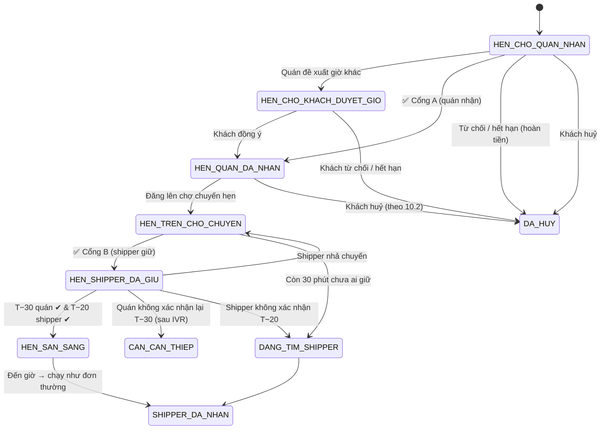

# Phần 10 — Đơn hẹn giờ & Bảng đơn trực tiếp cho Quán/Shipper

> Khi khách **không cần ngay** (hoặc đơn ngay đang phải chờ lâu), khách có thể **đặt hẹn giờ lấy/giao**. Đơn hẹn giờ được **hiển thị trực tiếp (realtime)** cho quán và shipper trong khu vực để **họ tự chọn nhận hay không**. Đơn chỉ được chốt khi **có người thật nhận** — đúng nguyên tắc cốt lõi của hệ thống.

---

## 10.1. Khi nào dùng đơn hẹn giờ

| Tình huống | Hệ thống làm gì |
|---|---|
| Khách chủ động chọn **"Hẹn giờ"** ở checkout | Chọn **giờ lấy** (hoặc giờ muốn nhận hàng) |
| **Đơn ngay chờ lâu**: quán chưa xác nhận sau 120 giây, hoặc không tìm được shipper sau 3 phút | Hiện gợi ý: *"Quán đang đông/Đang thiếu shipper. Bạn muốn **chuyển sang hẹn giờ** lúc 12:45 (sớm nhất có thể nhận) không?"* — 1 chạm chuyển, giữ nguyên giỏ |
| Quán đang đóng cửa | *"Quán mở lúc 6:00 — đặt trước cho 6:30?"* |
| Khu vực đang mưa bão / cao điểm | Gợi ý hẹn giờ ngoài cao điểm, **phí ship rẻ hơn** |
| Hàng cần chuẩn bị lâu (bánh kem, cỗ, mâm cúng, hoa) | Bắt buộc hẹn giờ, có thời gian đặt trước tối thiểu do quán quy định |

## 10.2. Trải nghiệm của khách

**Bộ chọn thời gian trực quan:**
```
Bạn muốn lấy/nhận hàng lúc nào?
[ Sau 1 giờ ] [ Sau 2 giờ ] [ Sau 3 giờ ] [ Chọn giờ… ]

Hôm nay  ▸  11:30  11:45  12:00 🔥  12:15  12:30  ...
            (ô màu xanh: quán & shipper còn nhiều chỗ;
             ô cam 🔥: cao điểm, có thể khó nhận;
             ô xám: quán đóng/kín lịch)
```
- Ba kiểu hẹn:
  - **"Giờ lấy hàng tại quán"** — giờ shipper lấy hàng đi (đúng ý *"bao nhiêu giờ lấy"*);
  - **"Giờ tôi nhận hàng"** — hệ thống tự trừ thời gian di chuyển để ra giờ lấy;
  - **"Tôi tự đến lấy lúc…"** (bản 1.0) — không cần shipper, chỉ cần quán nhận.
- Hẹn **sớm nhất 45 phút** kể từ lúc đặt (sớm hơn là đơn ngay), khung 15 phút, tối đa **7 ngày** tới; có **"Đặt định kỳ"** (mỗi ngày/tuần, giai đoạn sau).
- Hiển thị **xác suất được nhận** của từng khung giờ (do AI dự báo — Phần 12): *"Khả năng cao có quán & shipper nhận ✔"*.
- Sau khi đặt, đơn hiện thẻ **tím "Hẹn 12:00"** với các trạng thái:
  1. ⏳ *Đang chờ quán nhận* → 2. ✔ *Quán Bà Sáu đã nhận (cam kết chuẩn bị xong 11:55)* → 3. ⏳ *Đang chờ shipper giữ chuyến* → 4. ✔ *Anh Minh đã giữ chuyến* → 5. Đến giờ chạy như đơn thường.
- Khách có thể **sửa giờ / huỷ miễn phí** cho đến khi quán bắt đầu làm món, và chậm nhất 30 phút trước giờ hẹn (mốc nào đến trước thì áp dụng). Sửa giờ = quán phải nhận lại.

## 10.3. Hai hình thức gửi đơn hẹn giờ

### (A) Hẹn với một quán cụ thể
Khách chọn quán → đơn hiện trên **tab "Đơn hẹn" của quán** để quán quyết định.

### (B) "Yêu cầu mở" — gửi cho nhiều quán quanh khu vực ⭐ *(sáng tạo)*
Khách mô tả nhu cầu (chọn từ danh mục hoặc gõ/nói tự do), VD: *"2 bình nước 20L + 1 bao đá, lấy lúc 17:00"*.
- Yêu cầu hiển thị **trực tiếp** cho các quán phù hợp trong bán kính (cùng ngành, đang mở vào giờ đó, đủ uy tín).
- Quán bấm **"Tôi nhận được"** kèm giá + giờ chuẩn bị → khách thấy **danh sách báo giá** (giá, ★ uy tín, khoảng cách) và chọn 1, hoặc bật **"Tự chọn giúp tôi"**: chọn báo giá đầu tiên từ quán cấp Vàng trở lên trong mức giá tối đa khách đặt.
- Báo giá của quán chính là **Cổng A** (quán đã cam kết giá & giờ). Sau khi khách chọn, khách thanh toán (online hoặc COD theo điều kiện 10.7) và đơn chạy tiếp như đơn hẹn thường. Yêu cầu mở chỉ dùng cho đơn hẹn (≥ 45 phút).
- Hết hạn nhận báo giá (mặc định 15 phút hoặc 1/3 thời gian còn lại đến giờ hẹn) → nếu không có quán nào, báo khách và gợi ý giờ khác.

## 10.4. Bảng đơn hẹn giờ của QUÁN (realtime)

Tab **"Đơn hẹn 🟣"** trong app quán, có chấm đỏ đếm số đơn đang chờ quyết định:

```
┌─ ĐƠN HẸN ĐANG CHỜ BẠN ──────────────────────────┐
│ 🟣 Lấy lúc 12:00 (còn 2g15p)       Khách ✔ 25 đơn │
│ 3 cơm sườn, 2 trà đá · 165.000đ · 1,2 km        │
│ Hạn trả lời: 14:32 ⏳                            │
│ [ ✅ NHẬN ]   [ 🕑 Đề xuất giờ khác ]   [ ✖ ]   │
└─────────────────────────────────────────────────┘
  Lịch hôm nay:  11:00 ██  11:30 ████  12:00 ██████ (gần kín)
```
- **Lịch năng lực (capacity)**: quán đặt số đơn tối đa mỗi khung 15 phút; khung kín sẽ hiện xám bên phía khách.
- Thao tác: **Nhận** / **Đề xuất giờ khác** (khách đồng ý trong app) / **Từ chối** (chọn lý do).
- **Hạn trả lời của quán** = `min(30 phút, 50% thời gian còn lại tới giờ hẹn)`, tối thiểu 5 phút. Nhắc lại theo bậc như đơn ngay (push → SMS/ZNS → IVR) nhưng thưa hơn.
- Quán nhận → đơn vào **lịch sản xuất**; hệ thống **nhắc bắt đầu làm** lúc `giờ_hẹn − thời_gian_chuẩn_bị − 5 phút`.
- **Xác nhận lại trước giờ (T−30 phút)**: "Đơn 12:00 vẫn làm như kế hoạch?" — 1 chạm *Vẫn làm ✔*. Không phản hồi sau 10 phút → IVR → Ops. Bước này loại bỏ rủi ro quán quên đơn đặt từ hôm trước.

## 10.5. "Chợ chuyến hẹn" của SHIPPER (realtime) ⭐

Tab **"Chuyến hẹn 🟣"** trong app tài xế — danh sách/bản đồ các chuyến hẹn giờ trong khu vực **đã được quán nhận**, cập nhật trực tiếp (chuyến nào vừa có người giữ sẽ biến mất ngay, có hiệu ứng).

```
┌─ 🟣 12:00 · Cơm Tấm Bà Sáu → Toà A2 Sunrise ─────┐
│ 2,1 km · Thu nhập 24.000đ (+3.000 thưởng hẹn)    │
│ Quán ★4.8 🏅Vàng · Khách ✔25 đơn · Đã thanh toán │
│ Cách bạn hiện tại: 1,4 km                        │
│                         [ 🤚 GIỮ CHUYẾN NÀY ]    │
└──────────────────────────────────────────────────┘
Lọc: [Hôm nay] [Trên đường về nhà] [Gần tôi] [Thu nhập cao]
```
- **Ai thấy chuyến**: shipper đủ điều kiện (loại xe, hạn mức COD, **uy tín ≥ ngưỡng của khu vực**). Shipper **uy tín cao được thấy sớm hơn** (VD: Kim cương & Vàng thấy ngay, Bạc sau 5 phút, Đồng & Tân binh sau 10 phút; tính theo **cấp hiệu lực**, đã gồm điều chỉnh của Admin ở Phần 15) — phần thưởng thực chất cho uy tín (Phần 11).
- Với quán **tự giao**: chuyến hẹn hiện cho shipper của quán trước; hết hạn mới mở ra chợ hệ thống (nếu quán bật dự phòng).
- **Giữ chuyến = cam kết**. Giới hạn số chuyến hẹn giữ đồng thời theo hạng uy tín (Tân binh 🌱 & Đồng: 2, Bạc: 4, Vàng & Kim cương: 6; *Cần cải thiện*: không giữ chuyến hẹn) và không trùng khung giờ không khả thi (hệ thống kiểm tra lộ trình).
- Nếu **chưa ai giữ** khi còn 60 phút → tăng thưởng tự động; còn 30 phút → chuyển sang **điều phối chủ động** như đơn ngay (mời trực tiếp theo vòng, Phần 3). Còn 15 phút → Ops can thiệp.
- **Xác nhận lại trước giờ (T−20 phút)**: shipper bấm *"Tôi sẵn sàng"* và phải online, cách quán ≤ ETA hợp lý. Không xác nhận → mất chuyến, trừ điểm uy tín, chuyến được mời lại ngay với ưu tiên cao.
- **Huỷ chuyến hẹn**: trước T−2 giờ không phạt (tối đa 2 lần/tuần); sau đó trừ điểm tuỳ mức độ sát giờ.

## 10.6. Máy trạng thái của đơn hẹn giờ


Sau `SHIPPER_DA_NHAN`, đơn đi tiếp theo máy trạng thái chuẩn ở Phần 3.

## 10.7. Thanh toán & chính sách cho đơn hẹn
- Thanh toán online: **trừ tiền khi đặt** (giống đơn ngay, vì không phải ví/cổng nào cũng hỗ trợ tạm giữ tiền); quán từ chối, hết hạn hoặc huỷ hợp lệ → **hoàn tiền tự động** về nguồn thanh toán gốc.
- COD cho đơn hẹn chỉ mở với khách đã có **≥ 3 đơn hoàn thành và không bỏ đơn COD trong 90 ngày** (chống bom hàng đặt trước).
- Đơn giá trị cao/chuẩn bị lâu (bánh kem, cỗ): quán có thể yêu cầu **đặt cọc** (VD 30%).
- Phí ship được **khoá tại thời điểm đặt**; hẹn ngoài cao điểm có thể được **giảm phí ship** (khuyến khích dàn tải).

## 10.8. Bổ sung kỹ thuật
- Bảng mới:
  ```sql
  ALTER TABLE orders
    ADD COLUMN is_scheduled      BOOLEAN NOT NULL DEFAULT false,
    ADD COLUMN schedule_type     VARCHAR(10),          -- PICKUP, DELIVERY
    ADD COLUMN scheduled_pickup_at TIMESTAMPTZ,
    ADD COLUMN merchant_reply_deadline TIMESTAMPTZ,
    ADD COLUMN merchant_reconfirmed_at TIMESTAMPTZ,
    ADD COLUMN rider_reconfirmed_at    TIMESTAMPTZ;

  CREATE TABLE store_capacity_slots (
    store_id   BIGINT REFERENCES stores(id),
    slot_start TIMESTAMPTZ NOT NULL,        -- khung 15 phút
    max_orders INT NOT NULL,
    booked     INT NOT NULL DEFAULT 0,
    PRIMARY KEY (store_id, slot_start)
  );

  CREATE TABLE open_requests (              -- "Yêu cầu mở" gửi nhiều quán
    id           BIGSERIAL PRIMARY KEY,
    customer_id  BIGINT REFERENCES users(id),
    category     VARCHAR(40),
    description  TEXT NOT NULL,
    parsed_items JSONB,                     -- AI bóc tách món
    pickup_at    TIMESTAMPTZ NOT NULL,
    location     GEOGRAPHY(POINT, 4326) NOT NULL,
    status       VARCHAR(20) NOT NULL,      -- OPEN, AWARDED, EXPIRED, CANCELLED
    expires_at   TIMESTAMPTZ NOT NULL
  );

  CREATE TABLE open_request_bids (
    request_id BIGINT REFERENCES open_requests(id),
    store_id   BIGINT REFERENCES stores(id),
    price      BIGINT NOT NULL,
    prep_ready_at TIMESTAMPTZ NOT NULL,
    status     VARCHAR(20) NOT NULL,        -- SUBMITTED, WON, LOST, WITHDRAWN
    PRIMARY KEY (request_id, store_id)
  );

  CREATE TABLE scheduled_trip_claims (
    order_id   BIGINT PRIMARY KEY REFERENCES orders(id),
    rider_id   BIGINT REFERENCES riders(user_id),
    claimed_at TIMESTAMPTZ NOT NULL DEFAULT now(),
    released_at TIMESTAMPTZ
  );
  ```
- Giữ chuyến dùng **UPDATE có điều kiện + version** để đảm bảo **1 chuyến chỉ 1 shipper giữ** dù nhiều người bấm cùng lúc; người chậm hơn nhận thông báo "Chuyến vừa có người giữ" kèm gợi ý chuyến tương tự.
- Kênh WebSocket mới: `scheduled-board:zone:{h3_cell}` (shipper), `store:{id}:scheduled` (quán); sự kiện `trip_posted`, `trip_claimed`, `trip_released`, `bonus_updated`.
- Toàn bộ mốc nhắc (hạn trả lời, nhắc làm món, T−30, T−20, tăng thưởng) là **job hẹn giờ bền vững** (BullMQ + job quét đối chiếu từ PostgreSQL), không mất khi khởi động lại máy chủ.

## 10.9. API bổ sung
| Method | Path | Mô tả |
|---|---|---|
| GET | `/v1/stores/{id}/slots?date=` | Khung giờ còn nhận + xác suất được nhận |
| POST | `/v1/orders` (`schedule: {type, at}`) | Tạo đơn hẹn |
| POST | `/v1/orders/{id}/convert-to-scheduled` | Đơn ngay chờ lâu → hẹn giờ |
| POST | `/v1/open-requests` · GET `/v1/open-requests/{id}/bids` · POST `/v1/open-requests/{id}/award` | Yêu cầu mở |
| GET | `/v1/merchant/stores/{id}/scheduled?status=` | Bảng đơn hẹn của quán |
| POST | `/v1/merchant/orders/{id}/propose-time` · `/reconfirm` | Đề xuất giờ / xác nhận lại |
| POST | `/v1/merchant/open-requests/{id}/bids` | Quán báo giá yêu cầu mở |
| GET | `/v1/rider/scheduled-board?filter=` | Chợ chuyến hẹn |
| POST | `/v1/rider/scheduled-trips/{orderId}/claim` · `/release` · `/ready` | Giữ / nhả / sẵn sàng |
