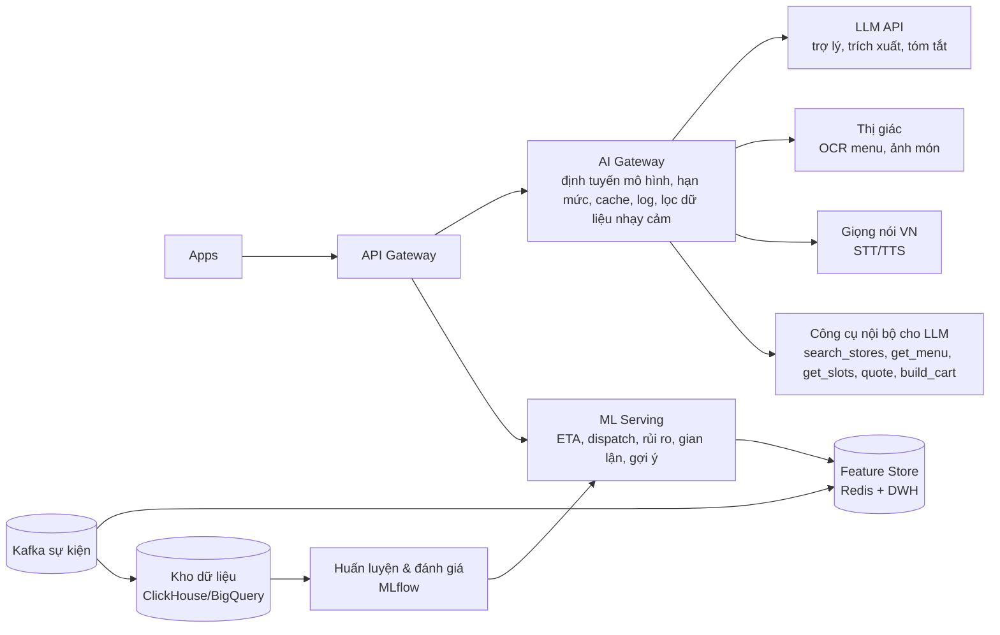

# Phần 12 — Tích hợp AI để gợi ý, tư vấn & vận hành thông minh

> **Nguyên tắc số 1: AI hỗ trợ, NGƯỜI THẬT quyết định.** AI **không bao giờ** tự xác nhận đơn thay quán hay nhận chuyến thay shipper. AI gợi ý, dự báo, soạn sẵn, cảnh báo — con người bấm xác nhận. Mọi tính năng AI đều có phương án chạy khi AI lỗi (fallback về quy tắc đơn giản).

---

## 12.1. Bản đồ ứng dụng AI

| # | Tính năng | Ai dùng | Loại AI | Ưu tiên |
|---|---|---|---|---|
| 1 | Gợi ý cá nhân hoá trang chủ | Khách | Hệ gợi ý (recommender) | P1 |
| 2 | **Trợ lý đặt hàng "Hỏi Quanh"** (chat/giọng nói) | Khách | LLM + công cụ (tool use) | P1 |
| 3 | Tìm kiếm hiểu ý (ngữ nghĩa, không dấu, lỗi chính tả) | Khách | Embedding + tìm kiếm lai | P1 |
| 4 | Gợi ý món thay thế khi hết hàng | Khách, Quán | Embedding món + quy tắc giá | P1 |
| 5 | Gợi ý món kèm / combo ("thêm trà đá?") | Khách | Luật kết hợp + recsys | P1 |
| 6 | Dự báo ETA (chuẩn bị + tìm shipper + di chuyển) | Tất cả | Hồi quy (gradient boosting) | P0 (đơn giản) → P1 (ML) |
| 7 | Dự báo xác suất được nhận cho khung giờ hẹn | Khách | Phân loại | P1 |
| 8 | Điều phối thông minh & ghép đơn | Hệ thống | Tối ưu hoá + ML điểm phù hợp | P1 |
| 9 | Dự báo nhu cầu theo ô H3 → định vị trước shipper | Shipper, Ops | Dự báo chuỗi thời gian | P1 |
| 10 | Giá cao điểm động có trần | Hệ thống | Dự báo cung/cầu + quy tắc | P1 |
| 11 | **Tạo menu từ ảnh** (OCR + chuẩn hoá) | Quán | Mô hình thị giác–ngôn ngữ | P1 |
| 12 | Làm đẹp ảnh món, viết mô tả món | Quán | Xử lý ảnh + LLM | P1 |
| 13 | **Trợ lý kinh doanh cho quán** | Quán | LLM + dữ liệu quán | P2 |
| 14 | Dự báo lượng đơn ngày mai/giờ cao điểm cho quán | Quán | Dự báo chuỗi thời gian | P2 |
| 15 | Tóm tắt & phân loại đánh giá, gợi ý trả lời | Quán | LLM | P1 |
| 16 | Bóc tách "Yêu cầu mở" (văn bản/giọng nói → danh sách món) | Khách, Quán | LLM trích xuất có cấu trúc | P1 |
| 17 | Gợi ý cá nhân cho shipper (nên chạy khu nào, giờ nào) | Shipper | Dự báo + tối ưu | P2 |
| 18 | Đọc thông báo/nhận lệnh bằng giọng nói khi lái xe | Shipper, Quán | Speech-to-text / Text-to-speech tiếng Việt | P1 |
| 19 | **Phát hiện gian lận** (đơn ảo, giả GPS, đánh giá ảo) | Ops | Phát hiện bất thường + đồ thị quan hệ | P1 |
| 20 | **Phát hiện đơn có nguy cơ** (sắp kẹt/trễ) trước khi xảy ra | Ops | Phân loại rủi ro realtime | P1 |
| 21 | **Trợ lý CSKH**: bot tự xử lý ca đơn giản, tóm tắt ca phức tạp cho nhân viên | Khách, CSKH | LLM + công cụ, có giới hạn quyền | P1 |
| 22 | Kiểm duyệt nội dung (ảnh món, đánh giá, chat) | Ops | Phân loại ảnh/văn bản | P1 |
| 23 | Kiểm tra hồ sơ eKYC, giấy phép (đọc, so khớp) | Admin | OCR + so khớp | P0 (qua nhà cung cấp) |
| 24 | Giải thích & gợi ý cải thiện điểm uy tín | Quán, Shipper | LLM trên số liệu điểm | P2 |

## 12.2. Chi tiết các tính năng nổi bật

### (2) Trợ lý đặt hàng "Hỏi Quanh" 🤖
- Khách gõ/nói: *"Tối nay mình 4 người, muốn ăn gì nóng nóng, dưới 300k, giao trước 7 giờ"*.
- AI gọi các **công cụ nội bộ** (tìm quán quanh vị trí, đọc menu, kiểm tra khung giờ hẹn, tính phí) → đề xuất 2–3 phương án dạng **thẻ trực quan** (ảnh món, tổng tiền, ETA, uy tín quán).
- Khách chọn → **giỏ hàng được điền sẵn** → khách tự bấm *Đặt hàng*. AI **không tự đặt**.
- Hiểu ngữ cảnh: dị ứng, ăn chay, ngân sách, số người, thời tiết, lịch sử.
- Ví dụ khác: *"Con mình sốt, nhà thuốc nào gần còn mở bán hạ sốt trẻ em?"* → liệt kê nhà thuốc mở, có sản phẩm OTC phù hợp, **kèm khuyến cáo hỏi dược sĩ/bác sĩ** — không đưa lời khuyên y tế thay chuyên gia.

### (6)(7) Dự báo ETA & xác suất nhận đơn hẹn
- Đặc trưng: quán, món, giờ, ngày, thời tiết, số đơn đang làm của quán, mật độ shipper trong ô, giao thông.
- Hiển thị khoảng tin cậy dễ hiểu: *"18–24 phút"*. Theo dõi độ chính xác hằng ngày (mục tiêu 80% đơn giao trong khoảng hiển thị).

### (8)(9) Điều phối & định vị trước
- Học từ lịch sử để tinh chỉnh trọng số `w1..w5` của điểm phù hợp (Phần 3), thử nghiệm A/B theo khu vực.
- Ghép đơn: bài toán định tuyến có cửa sổ thời gian (VRPTW) giải heuristic trong < 200 ms.
- Dự báo nhu cầu 30–60 phút tới cho từng ô H3 → bản đồ nhiệt cho shipper *"Khu Sunrise sắp đông đơn trưa — di chuyển tới để nhận nhiều chuyến hơn"*, thưởng định vị trước.

### (11)(12) AI cho quán nhỏ — "Mở quán online trong 5 phút"
- Chụp tờ menu/bảng giá → AI nhận dạng tên món, giá, nhóm → quán chỉnh và bấm *Đăng*.
- Chụp ảnh món bằng điện thoại → tự cắt nền, cân sáng, gợi ý mô tả: *"Cơm tấm sườn nướng than hồng, bì chả nhà làm, nước mắm pha chua ngọt"*.
- Gợi ý giá theo mặt bằng khu vực (tham khảo, quán tự quyết).

### (13)(14) Trợ lý kinh doanh cho quán
- Hỏi đáp bằng tiếng Việt: *"Tuần này món nào bán chậm?"*, *"Vì sao điểm uy tín giảm?"*.
- Chủ động nhắc: *"Mai thứ Bảy dự báo mưa, đơn tối có thể tăng 30% — chuẩn bị thêm nguyên liệu lẩu"*; *"Bạn có 5 đơn hẹn 11:30–12:00, nên bắt đầu làm lúc 11:10"*.
- Tóm tắt đánh giá: *"Khách khen sườn mềm; 4 khách phàn nàn cơm nguội khi giao xa > 3 km"* + gợi ý trả lời đánh giá.

### (19)(20) Vận hành thông minh cho Ops
- **Cảnh báo sớm**: mô hình chấm "nguy cơ trễ/kẹt" mỗi đơn mỗi 30 giây → đưa lên đầu hàng đợi Ops **trước khi** khách phàn nàn, kèm đề xuất hành động (*"Gán shipper X đang cách 600 m"*). Ops bấm duyệt.
- **Gian lận**: đồ thị liên kết tài khoản–thiết bị–địa chỉ–thanh toán, phát hiện cụm bất thường; quỹ đạo GPS bất thường. Kết quả là **cờ để người xem xét**, không tự khoá tài khoản (trừ trường hợp rõ ràng như giả GPS đã xác thực kỹ thuật).

### (21) Trợ lý CSKH
- Bot tự xử lý: tra cứu đơn, giải thích phí, hoàn tiền **trong hạn mức tự động đã quy định** (VD đơn bị quán huỷ), đổi địa chỉ khi shipper chưa lấy hàng.
- Ca phức tạp: chuyển nhân viên kèm **tóm tắt + bằng chứng + đề xuất xử lý**; nhân viên quyết định.
- Luôn có nút **"Gặp nhân viên"**.

## 12.3. Kiến trúc AI

- **LLM**: dùng API mô hình ngôn ngữ lớn hỗ trợ tiếng Việt tốt và gọi công cụ (tool use) — VD họ mô hình Claude: mô hình nhanh, chi phí thấp (`claude-haiku-5-5`) cho phân loại/trích xuất/bot số lượng lớn; mô hình mạnh hơn (`claude-sonnet-5-5`) cho trợ lý hội thoại và tóm tắt phức tạp. Lớp **AI Gateway** cho phép đổi nhà cung cấp/mô hình mà không sửa app.
- **ML truyền thống** (ETA, dispatch, gian lận, gợi ý): tự huấn luyện trên dữ liệu nền tảng (LightGBM/XGBoost, mô hình gợi ý hai tháp), phục vụ < 50 ms.
- **Công cụ cho LLM chỉ đọc hoặc tạo bản nháp** (giỏ hàng nháp, câu trả lời nháp); thao tác ghi quan trọng (đặt hàng, hoàn tiền vượt hạn mức, xác nhận đơn) **bắt buộc người bấm**.

## 12.4. An toàn, chi phí & chất lượng AI
| Vấn đề | Biện pháp |
|---|---|
| AI bịa thông tin (giá, món không có) | Trợ lý chỉ trả lời từ dữ liệu công cụ trả về; giá/món hiển thị luôn lấy từ hệ thống, không từ văn bản AI sinh |
| Dữ liệu cá nhân | Che SĐT/địa chỉ trước khi gửi mô hình bên ngoài; hợp đồng xử lý dữ liệu với nhà cung cấp; tuân thủ quy định bảo vệ dữ liệu cá nhân |
| Lời khuyên y tế/thuốc | Từ chối tư vấn điều trị, chỉ hỗ trợ tìm nhà thuốc & sản phẩm OTC, nhắc hỏi dược sĩ |
| Thiên lệch/không công bằng (điểm uy tín, dispatch) | Giám sát phân phối đơn & thu nhập giữa các nhóm/khu vực; giải thích được lý do |
| Chi phí | Cache câu trả lời phổ biến, dùng mô hình nhỏ cho tác vụ đơn giản, hạn mức theo người dùng, theo dõi chi phí/đơn (mục tiêu < 1% giá trị đóng góp mỗi đơn) |
| AI lỗi/chậm | Timeout 3–5 giây → về giao diện thường (tìm kiếm truyền thống, ETA theo trung bình lịch sử, quy tắc dispatch cố định) |
| Đánh giá chất lượng | Bộ kiểm thử tiếng Việt (câu hỏi thật đã ẩn danh), đo tỷ lệ trả lời đúng, tỷ lệ chuyển sang giỏ hàng, tỷ lệ chuyển nhân viên; A/B test trước khi mở rộng |
| Minh bạch | Gắn nhãn "✨ Gợi ý bởi AI" ở nội dung do AI tạo; quán duyệt mọi menu/mô tả AI soạn trước khi đăng |

## 12.5. Lộ trình AI
- **MVP:** ETA theo quy tắc + trung bình lịch sử; eKYC qua nhà cung cấp; tìm kiếm không dấu cơ bản.
- **1.0:** OCR menu, mô tả món, gợi ý món thay thế/kèm, tóm tắt đánh giá, bot CSKH cấp 1, ETA ML, xác suất khung giờ hẹn, bóc tách yêu cầu mở, cảnh báo đơn nguy cơ.
- **Tăng trưởng:** Trợ lý "Hỏi Quanh", gợi ý cá nhân hoá, dự báo nhu cầu & định vị trước shipper, dispatch học máy, phát hiện gian lận đồ thị, trợ lý kinh doanh cho quán, giọng nói khi lái xe.
