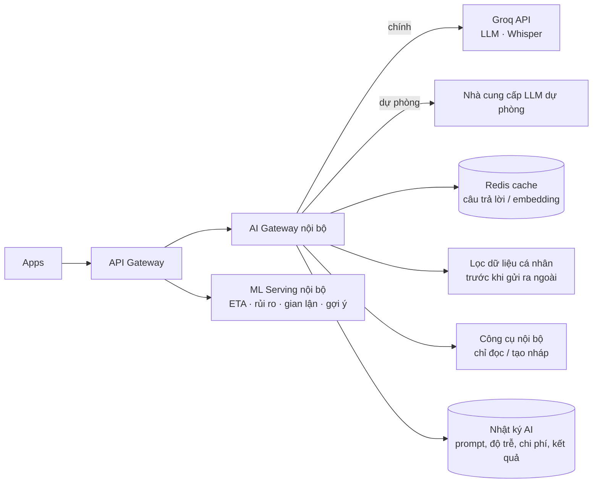

# Phần 12 — Tích hợp AI (Groq) để gợi ý, tư vấn & vận hành thông minh

> **Nhà cung cấp AI chính: Groq** — chọn vì **tốc độ suy luận rất nhanh** (độ trễ thấp, sinh chữ nhanh), phù hợp các tác vụ cần phản hồi tức thì như trợ lý đặt hàng, gợi ý trong lúc gõ, bóc tách yêu cầu, bot CSKH.
>
> **Nguyên tắc số 1: AI hỗ trợ, NGƯỜI THẬT quyết định.** AI **không bao giờ** xác nhận đơn thay quán, nhận chuyến thay shipper, hay tự hoàn tiền. AI gợi ý, dự báo, soạn sẵn, cảnh báo — con người bấm xác nhận. Mọi tính năng AI đều có **phương án chạy khi AI lỗi/chậm**, để ứng dụng **không bao giờ phụ thuộc vào AI để vận hành**.

---

## 12.1. Phân vai công nghệ AI

Không phải bài toán nào cũng nên giao cho mô hình ngôn ngữ lớn (LLM). Để **nhanh, rẻ và ổn định**, hệ thống chia ba nhóm:

| Nhóm | Dùng cho | Công nghệ |
|---|---|---|
| **LLM qua Groq** | Hiểu ngôn ngữ tự nhiên tiếng Việt, hội thoại, trích xuất có cấu trúc, tóm tắt, soạn nội dung | Groq API (tương thích chuẩn OpenAI), gọi công cụ (tool calling), đầu ra JSON |
| **Giọng nói → chữ qua Groq** | Đặt hàng bằng giọng nói, shipper/quán ra lệnh rảnh tay | Mô hình nhận dạng giọng nói họ Whisper trên Groq (hỗ trợ đa ngôn ngữ gồm tiếng Việt) |
| **Mô hình tự huấn luyện (không dùng LLM)** | ETA, điều phối, dự báo nhu cầu, gian lận, xếp hạng gợi ý | LightGBM/XGBoost, mô hình gợi ý; phục vụ nội bộ < 50 ms |
| **Dịch vụ chuyên biệt khác** | Đọc chữ trên ảnh (OCR) menu/CCCD, chuyển chữ → giọng nói tiếng Việt, embedding tìm kiếm ngữ nghĩa | OCR & eKYC của nhà cung cấp VN; TTS tiếng Việt (FPT.AI/Viettel AI/Zalo AI…); mô hình embedding đa ngôn ngữ tự host (VD bge-m3, multilingual-e5) |

> Lý do không dồn hết lên Groq: các bài toán số (ETA, dispatch) cần **chính xác, rẻ, chạy mỗi giây** — mô hình ML thường tốt hơn LLM. Groq tập trung ở nơi phát huy thế mạnh: **ngôn ngữ + tốc độ**.

## 12.2. Danh sách tính năng AI (đã rà soát, gộp và loại bớt)

| # | Tính năng | Người dùng | Công nghệ | Ưu tiên |
|---|---|---|---|---|
| 1 | Tìm kiếm hiểu ý: không dấu, sai chính tả, đồng nghĩa ("trà sữa" ≈ "milk tea") | Khách | Tìm kiếm lai: từ khoá + embedding | P1 |
| 2 | Gợi ý món thay thế khi hết hàng, món kèm/combo | Khách, Quán | Embedding món + quy tắc giá | P1 |
| 3 | **Trợ lý "Hỏi Quanh"** (chat/giọng nói) đề xuất quán & món, điền sẵn giỏ hàng | Khách | **Groq LLM** + công cụ nội bộ | P1 |
| 4 | Bóc tách **"Yêu cầu mở"** / ghi chú tự do thành danh sách món có cấu trúc | Khách, Quán | **Groq LLM** (JSON) | P1 |
| 5 | Đặt hàng & ra lệnh bằng giọng nói | Khách, Quán, Shipper | **Groq Whisper** + Groq LLM hiểu ý | P1 |
| 6 | Tạo menu từ ảnh: OCR → **Groq chuẩn hoá** tên món, giá, nhóm, tuỳ chọn | Quán | OCR + **Groq LLM** | P1 |
| 7 | Viết mô tả món hấp dẫn, gợi ý tên combo | Quán | **Groq LLM** | P1 |
| 8 | Tóm tắt đánh giá, gợi ý câu trả lời khách | Quán | **Groq LLM** | P1 |
| 9 | **Bot CSKH cấp 1**: tra cứu đơn, giải thích phí, hướng dẫn; tóm tắt ca cho nhân viên | Khách, CSKH | **Groq LLM** + công cụ chỉ đọc | P1 |
| 10 | Kiểm duyệt nội dung chat/đánh giá (lăng mạ, lừa đảo, lộ SĐT) | Ops | **Groq LLM** phân loại + bộ lọc từ khoá | P1 |
| 11 | Giải thích điểm uy tín & gợi ý cải thiện bằng lời dễ hiểu | Quán, Shipper | **Groq LLM** trên số liệu có sẵn | P1 |
| 12 | Trợ lý kinh doanh cho quán (hỏi đáp doanh thu, nhắc chuẩn bị theo dự báo) | Quán | **Groq LLM** + số liệu tính sẵn | P2 |
| 13 | Dự báo ETA (chuẩn bị + tìm shipper + di chuyển) | Tất cả | ML tự huấn luyện | P0 quy tắc → P1 ML |
| 14 | Xác suất được nhận cho khung giờ hẹn | Khách | ML phân loại | P1 |
| 15 | Dự báo nhu cầu theo khu vực → bản đồ nhiệt & gợi ý vị trí cho shipper | Shipper, Ops | ML chuỗi thời gian | P1 |
| 16 | Cảnh báo sớm đơn có nguy cơ trễ/kẹt + đề xuất hành động | Ops | ML phân loại rủi ro | P1 |
| 17 | Phát hiện gian lận (đơn ảo, giả GPS, đánh giá ảo) | Ops | Phát hiện bất thường + đồ thị liên kết | P1 |
| 18 | Tinh chỉnh điều phối & ghép đơn | Hệ thống | Tối ưu hoá + ML | P2 |

**Đã loại bỏ / gộp sau rà soát:**
- ~~Làm đẹp ảnh món bằng AI~~ → thay bằng **bộ lọc ảnh đơn giản + hướng dẫn chụp** (tránh ảnh "ảo" khác món thật, gây khiếu nại).
- ~~AI gợi ý giá cho quán~~ → chỉ hiển thị **mặt bằng giá khu vực dạng số liệu**, không để AI "khuyên" giá (rủi ro bị coi là can thiệp giá).
- ~~AI tự hoàn tiền~~ → hoàn tiền tự động chỉ theo **quy tắc cố định** (quán huỷ, không tìm được shipper…), không do LLM quyết định.
- ~~Tư vấn thuốc~~ → bot chỉ giúp **tìm nhà thuốc đang mở**; mọi câu hỏi về điều trị/liều dùng trả lời: *"Bạn vui lòng hỏi dược sĩ/bác sĩ"*.
- Gợi ý riêng cho shipper gộp vào #15; giải thích uy tín gộp thành #11.

## 12.3. Chi tiết các luồng dùng Groq

### (3) Trợ lý "Hỏi Quanh"
1. Khách gõ/nói: *"Tối nay 4 người, muốn ăn gì nóng, dưới 300k, giao trước 7 giờ"*.
2. Backend gửi tới Groq kèm **danh sách công cụ nội bộ** (tool calling):
   - `search_stores(lat, lng, category, open_at, max_eta)`
   - `get_menu(store_id)`
   - `get_slots(store_id, date)`
   - `quote_cart(store_id, items)`
   - `build_cart_draft(store_id, items)` ← chỉ tạo **giỏ nháp**
3. Groq quyết định gọi công cụ nào; backend thực thi, trả kết quả; Groq soạn câu trả lời ngắn + **2–3 thẻ đề xuất** (ảnh món, tổng tiền, ETA, cấp uy tín quán — **lấy từ dữ liệu hệ thống, không từ chữ AI sinh**).
4. Khách chạm một thẻ → giỏ nháp mở ra → **khách tự bấm Đặt hàng** → quán xác nhận như mọi đơn.
- Trả lời dạng **streaming** (chữ hiện dần) — với tốc độ của Groq, khách thấy phản hồi gần như ngay lập tức.
- Giới hạn: tối đa 4 vòng gọi công cụ/câu hỏi, 10 câu hỏi/phiên/phút/người dùng.

### (4) Bóc tách yêu cầu tự do → JSON
Đầu vào: *"2 bình Lavie 20L với 1 bao đá, 5h chiều nay giao lên tầng 3"*
Đầu ra bắt buộc theo **lược đồ JSON** (kiểm tra bằng JSON Schema ở backend; sai lược đồ → hỏi lại khách, không đoán):
```json
{
  "items": [
    {"name": "Nước Lavie bình 20L", "quantity": 2, "category": "WATER"},
    {"name": "Đá viên bao", "quantity": 1, "category": "ICE"}
  ],
  "schedule": {"type": "DELIVERY", "local_time": "17:00", "date": "today"},
  "dropoff_note": "Giao lên tầng 3",
  "confidence": 0.93
}
```
`confidence < 0.8` hoặc thiếu thông tin → hiện màn hình để khách **xác nhận/sửa** trước khi gửi cho quán.

### (5) Giọng nói
- App ghi âm → gửi **Groq Whisper** (nhận dạng tiếng Việt) → văn bản → luồng (3)/(4).
- Shipper đang lái xe: chỉ hỗ trợ **lệnh ngắn** ("nhận chuyến", "gọi khách", "đã tới") — nhận dạng xong **đọc lại để xác nhận** trước khi thực hiện; lệnh "đã giao" vẫn bắt buộc ảnh/PIN.
- Chữ → giọng nói (đọc đơn mới cho quán, đọc thông báo cho shipper) dùng **TTS tiếng Việt** của nhà cung cấp trong nước (giọng tự nhiên, vùng miền), có bản thu âm sẵn cho câu cố định để không phụ thuộc mạng.

### (6) Menu từ ảnh
OCR đọc chữ → Groq chuẩn hoá thành `[{section, name, price, options}]` → **quán xem lại từng dòng và bấm Đăng**. Không bao giờ tự đăng.

### (9) Bot CSKH
- Công cụ **chỉ đọc**: `get_order_status`, `get_fee_breakdown`, `get_policy`.
- Hành động có ảnh hưởng (hoàn tiền, huỷ đơn đã làm, đền bù) → **tạo ticket kèm tóm tắt** cho nhân viên; nếu thuộc trường hợp hoàn tiền tự động theo quy tắc thì quy tắc xử lý, bot chỉ thông báo.
- Luôn có nút **"Gặp nhân viên"**; phát hiện khách bức xúc (từ ngữ, lặp lại) → chuyển người ngay.

## 12.4. Kiến trúc tích hợp Groq



**AI Gateway** (một module trong backend) là nơi duy nhất gọi Groq:
- **API tương thích OpenAI**: base URL `https://api.groq.com/openai/v1`, dùng SDK OpenAI-compatible → **đổi nhà cung cấp chỉ bằng cấu hình**.
- **Tên model đặt trong cấu hình, không gắn cứng trong code** — danh mục model của Groq thay đổi và có lịch ngừng hỗ trợ (deprecation). Cấu hình theo tác vụ:
  ```yaml
  ai:
    provider: groq
    tasks:
      assistant_chat:   { model: "<model lớn, hỗ trợ tool calling>", max_tokens: 600, timeout_ms: 4000, stream: true }
      extract_json:     { model: "<model nhỏ, nhanh>", response_format: json, timeout_ms: 2000 }
      moderation:       { model: "<model nhỏ, nhanh>", timeout_ms: 1500 }
      summarize_review: { model: "<model trung bình>", timeout_ms: 5000, batch: true }
      speech_to_text:   { model: "<whisper-large-v3 hoặc bản turbo>", language: "vi" }
    fallback_provider: "<nhà cung cấp dự phòng>"
  ```
  → **Trước khi triển khai**: kiểm tra danh sách model hiện hành, giới hạn tốc độ và chính sách dữ liệu trên console Groq; chọn model bằng **bộ đánh giá tiếng Việt** ở 12.6 (chất lượng tiếng Việt giữa các model chênh lệch đáng kể).
- **Giới hạn tốc độ (rate limit)**: Groq giới hạn theo số yêu cầu và số token mỗi phút/ngày theo gói tài khoản. Gateway có **hàng đợi + token bucket** riêng, khi gặp lỗi `429` → thử lại có backoff ngắn (theo header thời gian chờ) → quá 1 lần thì **chuyển nhà cung cấp dự phòng** hoặc **chế độ không-AI**.
- **Timeout cứng** theo tác vụ (1,5–5 giây) + **circuit breaker**: lỗi liên tục → tạm ngắt Groq 60 giây, tự thử lại.
- **Cache**: câu hỏi phổ biến, kết quả chuẩn hoá menu, mô tả món → giảm chi phí & độ trễ.
- **Nhật ký & đo lường**: độ trễ token đầu tiên, tổng thời gian, số token, chi phí/tác vụ, tỷ lệ lỗi, tỷ lệ fallback.

## 12.5. Khi AI lỗi — ứng dụng vẫn chạy bình thường

| Tính năng | Khi Groq lỗi/chậm/hết hạn mức |
|---|---|
| Trợ lý "Hỏi Quanh" | Ẩn ô chat, hiện **tìm kiếm thường + bộ lọc**; thông báo nhẹ "Trợ lý đang bận" |
| Bóc tách yêu cầu mở | Hiện **form chọn món theo danh mục** |
| Giọng nói | Ẩn nút micro, dùng bàn phím |
| Menu từ ảnh | Nhập tay (vẫn có OCR thô nếu dịch vụ OCR còn chạy) |
| Bot CSKH | Chuyển thẳng nhân viên / FAQ tĩnh |
| Kiểm duyệt | Bộ lọc từ khoá + hậu kiểm thủ công |
| Mô tả món, tóm tắt đánh giá | Xử lý lại sau (hàng đợi), không chặn quán |

**Không có luồng cốt lõi nào (đặt hàng, xác nhận, điều phối, thanh toán, giao hàng) phụ thuộc vào Groq.**

## 12.6. Chất lượng, an toàn, chi phí

| Vấn đề | Biện pháp |
|---|---|
| Chất lượng tiếng Việt | Bộ đánh giá ≥ 300 câu thật (ẩn danh): tiếng lóng, không dấu, phương ngữ Bắc–Trung–Nam, teencode; đo tỷ lệ hiểu đúng & tỷ lệ chuyển thành giỏ hàng; chạy lại mỗi lần đổi model |
| AI bịa thông tin | Chỉ trả lời từ dữ liệu công cụ; giá/món/thời gian **luôn hiển thị từ hệ thống**; prompt hệ thống cấm suy đoán; kiểm tra JSON Schema |
| Dữ liệu cá nhân | **Che SĐT, địa chỉ chi tiết, tên** trước khi gửi Groq (thay bằng mã); chỉ gửi dữ liệu tối thiểu; xin đồng ý của người dùng cho tính năng AI; ghi rõ trong chính sách bảo mật việc **chuyển dữ liệu ra nước ngoài** và thực hiện thủ tục theo quy định bảo vệ dữ liệu cá nhân; kiểm tra điều khoản lưu trữ dữ liệu của Groq và chọn chế độ không lưu dữ liệu nếu có |
| Tấn công prompt (prompt injection) qua tên món/ghi chú | Dữ liệu người dùng đưa vào prompt được đánh dấu là dữ liệu; công cụ chỉ đọc/tạo nháp nên không thể gây hành động nguy hiểm |
| Chi phí | Model nhỏ cho tác vụ đơn giản, cache, giới hạn theo người dùng, theo dõi **chi phí AI/đơn** (mục tiêu < 1% giá trị đóng góp mỗi đơn); ngân sách tháng có cảnh báo |
| Minh bạch | Nhãn "✨ Gợi ý bởi AI" trên nội dung AI tạo; quán duyệt mọi nội dung AI soạn trước khi đăng |
| Công bằng (dispatch, uy tín) | Không dùng LLM cho quyết định chấm điểm/chia đơn; mô hình ML được giám sát phân phối thu nhập giữa khu vực/nhóm |

## 12.7. Lộ trình AI
- **MVP (không phụ thuộc AI):** ETA theo quy tắc + trung bình lịch sử; tìm kiếm không dấu cơ bản (PostgreSQL `unaccent` + `pg_trgm`); eKYC qua nhà cung cấp. Dựng sẵn **AI Gateway** và tài khoản Groq để thử nghiệm nội bộ.
- **1.0:** Menu từ ảnh, mô tả món, bóc tách yêu cầu mở, tóm tắt đánh giá, kiểm duyệt nội dung, bot CSKH cấp 1, giọng nói, gợi ý món thay thế/kèm, ETA bằng ML, cảnh báo đơn nguy cơ.
- **Tăng trưởng:** Trợ lý "Hỏi Quanh" mở cho toàn bộ khách (sau A/B test), dự báo nhu cầu & bản đồ nhiệt, phát hiện gian lận đồ thị, trợ lý kinh doanh cho quán, tinh chỉnh điều phối.
